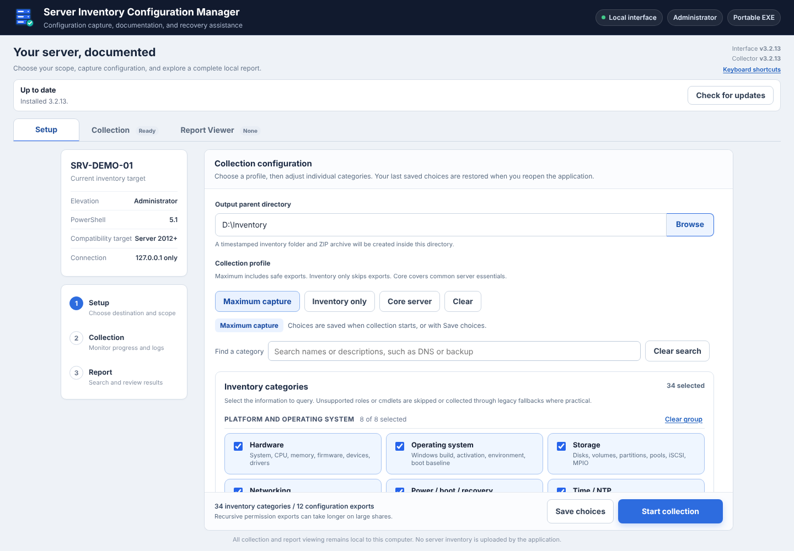
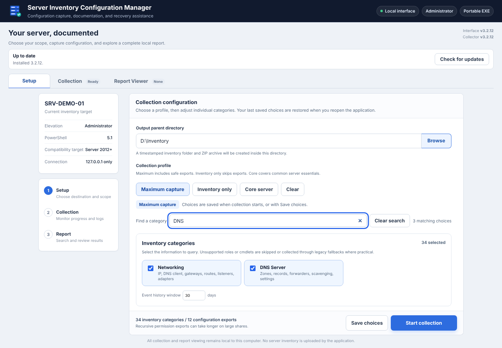
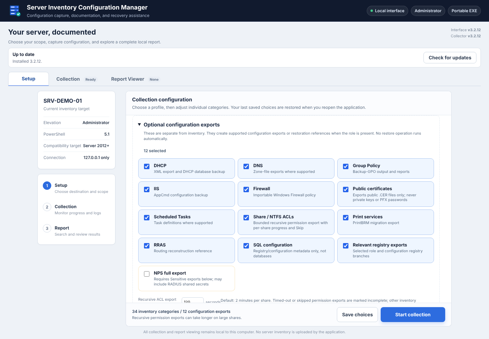
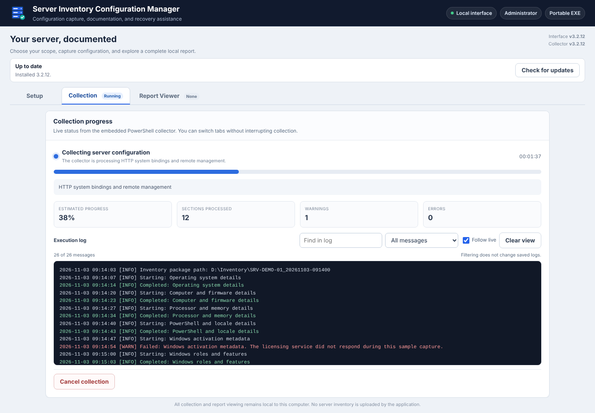
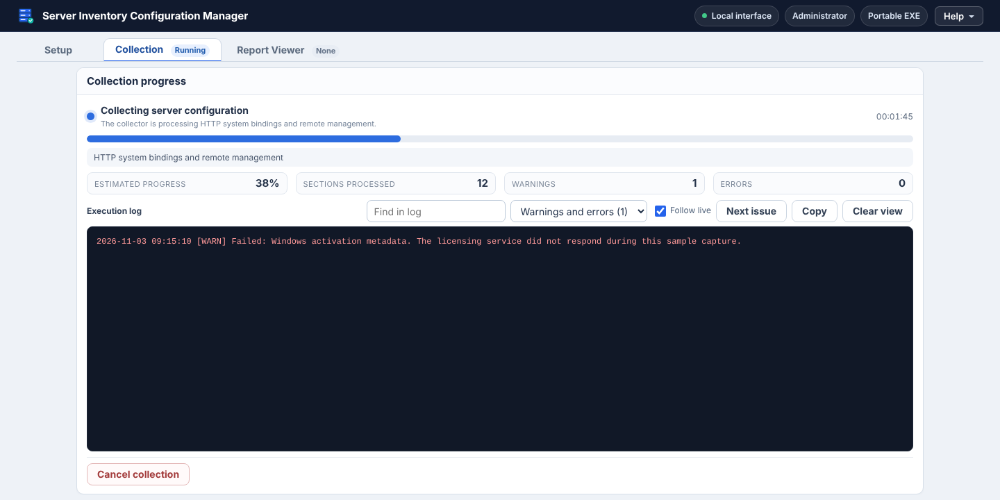
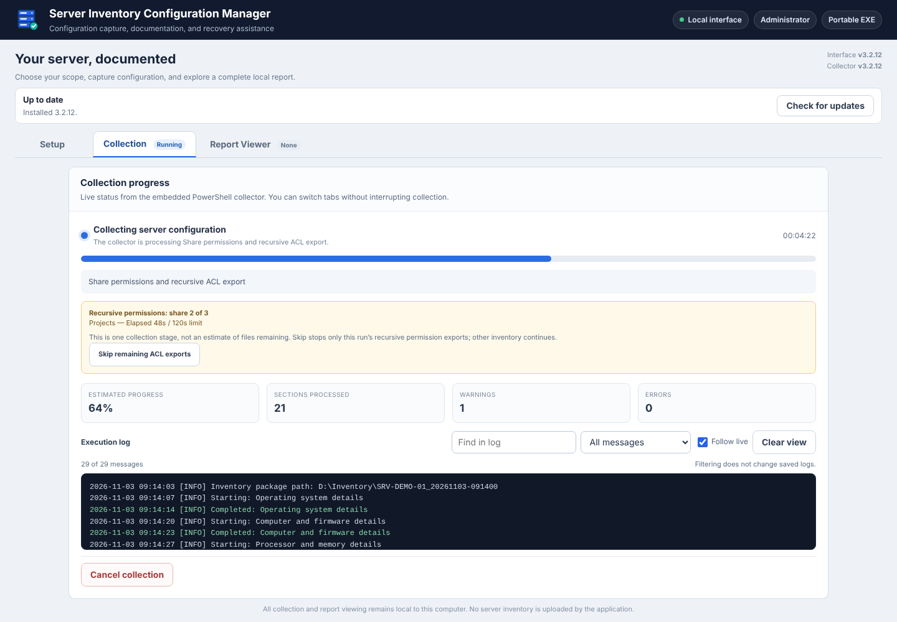
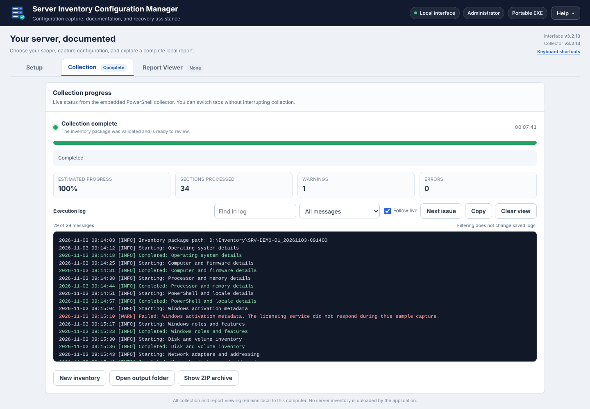
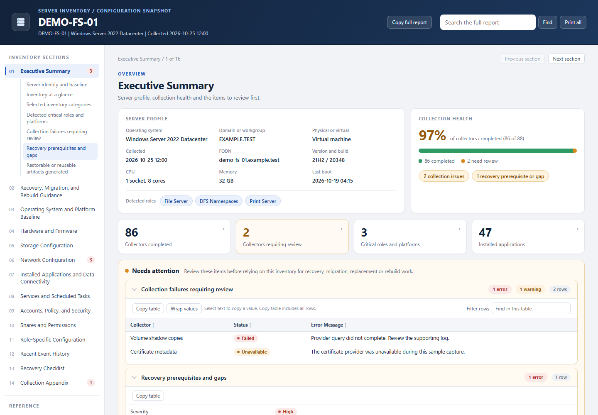
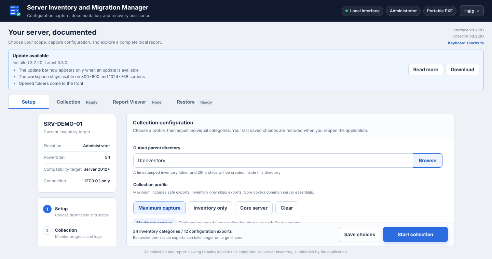

<p align="center">
  
</p>

<h1 align="center">Server Inventory Configuration Manager</h1>
<p align="center"><strong>Capture server configuration. Find the important details. Keep a useful handoff.</strong></p>

<p align="center">
  <a href="https://github.com/TechSavage1989/Server-Inventory-Configuration-Manager/releases/latest">Download</a> ·
  <a href="#getting-started">Get started</a> ·
  <a href="#features">Features</a> ·
  <a href="#screenshots">Screenshots</a> ·
  <a href="#development">Development</a>
</p>

<p align="center">
  
</p>

A portable **Windows x64 application** for collecting server inventory, exporting supported configurations, and reviewing clear, searchable reports.

## Features

| Capture | Review | Keep working |
| --- | --- | --- |
| Choose inventory categories and optional configuration exports. | Start with an executive summary and visible collection issues. | Run a portable EXE with an isolated local browser interface. |
| Search grouped categories, use presets, and save or revert your preferred scope. | Search collapsed report sections and inspect supporting exports. | Keep settings, window placement, and shortcut targets through updates. |
| Collect available server-role details without treating missing roles as present. | Open HTML offline, print retained report data, or use Word/text outputs. | Choose when to download, install, and restart. |

## Screenshots

### Capture

<table>
  <tr><td width="50%"><b>Category search without changing the selected scope</b><br></td><td width="50%"><b>Optional configuration exports</b><br></td></tr>
</table>

### Collection

<table>
  <tr><td width="50%"><b>Collection progress with a searchable live log</b><br></td><td width="50%"><b>Log filtered to warnings and errors</b><br></td></tr>
  <tr><td width="50%"><b>Bounded recursive permission export with Skip</b><br></td><td width="50%"><b>Validated collection ready to review</b><br></td></tr>
</table>

### Review

**HTML report executive summary**



### Keep working

**Update available with release notes; you choose when to download**



## Download

Get the maintained **Windows EXE** from [the current release](https://github.com/TechSavage1989/Server-Inventory-Configuration-Manager/releases/latest), with its checksum and release notes. The historical PS1 application is not the current product.

Direct links: [Download Windows EXE](https://github.com/TechSavage1989/Server-Inventory-Configuration-Manager/releases/latest/download/Server-Inventory-Configuration-Manager.exe) · [Releases & checksums](https://github.com/TechSavage1989/Server-Inventory-Configuration-Manager/releases)

## Requirements

- **Windows x64**, with Windows Server 2012+ as the compatibility target. Older Windows/PowerShell and individual server roles still require field validation; see [docs/VALIDATION.md](docs/VALIDATION.md).
- **Built-in Windows PowerShell** for inventory collection and the permissions required to query/export the selected scope. Run with administrator rights for administrator-only data.
- **Microsoft Edge or Chrome** with guest browsing permitted by your organization. The app does not bypass browser policies. Version 109, the last release for Windows Server 2012 and 2012 R2, is supported.
- A display of **800×600 or larger**. On small screens the header and panels become compact so the settings, log and report stay reachable.
- A writable application location and output folder. Go, Python, and Node.js are **build tools**, not normal application requirements.

## Getting started

1. Download **`Server-Inventory-Configuration-Manager.exe`** from the current [release](https://github.com/TechSavage1989/Server-Inventory-Configuration-Manager/releases/latest). Use its checksum file if you want to verify downloaded bytes.
2. Keep the EXE in a permanent writable folder, then launch it with the permissions appropriate to your authorized server work.
3. In **Setup**, choose the **Output parent directory**. Pick **Inventory only**, **Core server**, or **Maximum capture**, then review the individual categories and optional exports.
4. Use **Save choices** to remember the configuration, or start collection to save and run it. In **Collection**, search the log, filter warnings/errors, or pause **Follow live** to inspect earlier output.
5. Open **Report Viewer**, inspect collection failures/recovery gaps first, then search the details and supporting files in your output folder.

> **Protect your exports.** Inventory and configuration files can contain sensitive infrastructure information. Review the scope and sensitive-data options before collecting; store and share the output securely. Configuration exports and recovery references are not a substitute for a tested backup, and no restore runs automatically.

**Coming from an older version?** The original v3.0.10 EXE and historical v3.1.0 PS1 application need one manual download of the maintained EXE. The PS1 application is historical—not the current product or build baseline. Existing executable updates preserve the installed path, including custom filenames.

## How to use

Setup shows the selected profile and exact inventory/export counts. Inventory categories are grouped (platform, workloads, identity and network roles, file/print/backup, security and diagnostics), each with a running count and a one-click Select all / Clear group. Categories with an enabled configuration export carry a **+ export** tag. Search by category name or description without altering your selections; optional exports expand when needed and empty groups hide. Unchecking an inventory category also clears its dependent export. Saved safe choices return at the next launch, and **Revert to saved** undoes unsaved edits. Sensitive permission and NPS full export must be selected again each session.

Use the Collection log's search and severity filter to focus on issues; the filter shows live warning/error counts. **Next issue** (or `N`) steps through warnings and errors, clicking the Warnings or Errors tile filters the log, and **Copy** copies the messages currently shown. Scrolling back pauses live following; enable Follow live to return to the newest output. Filtering and Clear view do not alter saved diagnostic files. After a run, **Open output folder** and **Show ZIP archive** go straight to the package and bring the folder window to the front. The window title shows progress (for example `42% Collecting`) so you can follow a run from the taskbar.

In the Report Viewer search, `Enter` moves to the next match and `Shift+Enter` to the previous one (`F3` / `Shift+F3` also work); `Esc` clears the search.

**Keyboard shortcuts** (press `?` or choose **Help → Keyboard shortcuts**): `Alt+1/2/3` switch tabs, `/` or `Ctrl+K` focuses the current tab's search, `Ctrl+S` saves choices and `Ctrl+Enter` starts collection from Setup.


New HTML reports open on an executive summary: the server profile and detected roles, collection health with links to each collection issue and recovery gap, and inventory counts that jump to their datasets. Items that need attention stay expanded at the top; routine datasets expand on demand. Each section starts with a contents panel that groups its datasets under their headings, shows row counts and marks datasets with failures or warnings. Datasets that returned no data are gathered into one collapsed **No data collected** group instead of a long run of empty entries. Name/value lists and single-record tables read as property sheets. Search includes collapsed sections and raw text. Hover any value and choose **Copy** to copy just that value; **Copy table**, **Copy section** and **Copy full report** copy more, and **Copy path** in the Report Viewer copies the report file location. The report uses the full window width. Printing includes all rows retained by the report snapshot; truncation notices still point to complete supporting exports.

In the report, the section menu shows a badge counting failed, high-severity and warning items so you know where to look first, and it highlights the subsection you are reading. Numeric columns are right-aligned, and each section has **Print section** alongside Print all. The report stays legible on 800 × 600 and 1024 × 768 screens, standalone or in the Report Viewer. Pressing `Enter` again in report search moves to the next match (`Shift+Enter` goes back, `Esc` clears) and the message names the section. `[` and `]` move between sections, `/` focuses search, and a **Back to top** button appears on long sections.

HTML reports work offline without external fonts, libraries, or image services. Existing reports remain readable in the viewer; **generate a new report to get the redesigned layout**. Word, text, and raw outputs remain available.

## Updates and settings

The update bar appears only when an update is available; then use **Download → Install and restart**. To check yourself, or to see the installed version and the result of the last check, choose **Help → Check for updates…**. Checks also run after the interface renders, every five active minutes, and after focus return when at least two minutes have elapsed. Download, installation, and restart always require explicit actions. Installation is blocked during collection and report/folder operations.

The updater verifies HTTPS hosts, repository/version paths, size, SHA-256, PE structure, and Windows application/version metadata. **A matching hash is integrity validation, not publisher signing.** A native helper replaces the EXE and restores the previous one if the expected rendered, visible startup is not confirmed.

Settings, logs, cache, staging, rollback, and browser-session files live under:

```text
%LOCALAPPDATA%\Server Inventory Configuration Manager\
```

Reports stay in the selected output folder. Updates preserve your executable path and shortcut targets.

### Desktop behavior

- **Isolated browser session:** Edge/Chrome runs in an app-owned guest profile with extensions and account sync disabled. The app never falls back to your personal profile or changes browser settings/policies. If guest mode is blocked, it reports the limitation.
- **Remembered window:** the last usable position, size, and maximized state are saved separately in `Settings/window.json`. Minimized windows reopen normally or maximized; off-screen positions move into an available work area.
- **Consistent icon:** the editable SVG is compiled into the EXE. Targeted shell notifications and exact-target shortcut icon repairs preserve launch properties, leave unrelated shortcuts alone, and do not restart Explorer.

## Development

Read [AGENTS.md](AGENTS.md) and [DEVELOPMENT_HANDOFF.md](DEVELOPMENT_HANDOFF.md) first. [docs/VALIDATION.md](docs/VALIDATION.md) records provenance, hosted test evidence, and field-testing limits. The maintained application preserves the original executable's collectors and behavior; `legacy` is historical material, not the build source.

<details>
<summary><strong>Build, icon editing, and report-renderer notes</strong></summary>

### Build

Requires Go 1.20.14, Python 3, Node.js 22 for build-only icon rendering, and Windows PowerShell for validation. The updater is native Go/Win32. Inventory collection uses built-in Windows PowerShell as in the original executable.

1. Run npm ci --prefix scripts/icon-tools and node scripts/build_icons.cjs --check, then python scripts/verify_baseline.py.
2. Run python scripts/embed_report_renderer.py --check and scripts/Test-Report.ps1. Generate fixture reports before Go tests; run scripts/test_report.cjs with Playwright/Edge before packaging.
3. Run `python scripts/build_resources.py --version <source-version>` using the version in `src/app/main.go`.
4. Run scripts/Test-Source.ps1.
5. Run go build -trimpath -ldflags "-s -w -H=windowsgui" -o build/Server-Inventory-Configuration-Manager.exe ./src/app
6. Run go test -v ./... and go vet ./....
7. Run scripts/Test-Binary.ps1 and scripts/Test-UpdateInstall.ps1 with the EXE path and expected version.

The original collector is committed directly. Original icon bytes are retained under baseline/v3.0.10/icons. The new SVG-derived icon and Windows version metadata are linked during compilation, without patching the built EXE.

### Editable application icon

The user-supplied Illustrator master is `src/app/assets/icons/source/server-inventory-illustrator.svg`, preserved byte for byte with its editable payload. Edit that master in Illustrator; do not replace it with a raster or manually edit the generated `src/app/assets/icons/server-inventory.svg`.

Run `npm ci --prefix scripts/icon-tools`, `python tests/test_icon_source.py`, and `node scripts/build_icons.cjs` after an approved artwork update. The narrow build-only converter derives a safe runtime SVG with inline vector fills/strokes, removing the external DTD, editor-only foreign object and Illustrator payload without loading external resources. Unsupported drawing features fail closed. The pinned renderer compares every 16–256px runtime frame against the original vector/CSS presentation, then generates the PNG, ten ICO sizes and provenance hashes. Review the source-identity fixture when approving a new master; CI runs the same negative controls and deterministic `--check` so future builds cannot silently revert it. Node/Python are build tools only, not application/updater dependencies.

Both the original `Server-Inventory-Configuration-Manager-Illustrator.svg` and the safe runtime `Server-Inventory-Configuration-Manager.svg`, with their checksums, are included in each new executable release. The same ICO is compiled into the EXE for Explorer. After the interface starts, native shell notifications refresh that executable and existing shortcuts targeting it. Current-user desktop shortcuts use a persistent artwork-specific ICO beneath LocalAppData/Server Inventory Configuration Manager/Icons; public-desktop and portable-folder shortcuts use the embedded EXE icon so they remain readable by other users. Shortcut targets and launch properties are preserved. Unrelated shortcuts are not changed, and Explorer is not restarted. Redirected desktop folders are discovered through Windows known folders.


### Report renderer

Edit the presentation sources under reporting, then run python scripts/embed_report_renderer.py. This embeds CSS/JS into the original self-contained collector. docs/verification/report-verification.json tracks approved presentation hashes; the original renderer and whole-script baseline hash remain unchanged. The Word report, text summary, collectors and raw outputs are preserved. The app viewer supports both report generations. Generate a new report to use the new layout.

</details>

### Repository layout

Application sources, embedded collectors, UI and icons live together in `src/app/`; Go tests stay beside their package. `scripts/` holds build/validation tools, `tests/` shared fixtures, `reporting/` editable report templates, and `docs/` validation, provenance and release notes. `baseline/` and `legacy/` retain historical originals; neither is a replacement application baseline. Build output belongs in ignored `build/` and `dist/`. Run `python scripts/check_layout.py` before committing.
