<p align="center">
  
</p>

<h1 align="center">Server Inventory and Migration Manager</h1>
<p align="center"><strong>Capture server configuration. Find the important details. Keep a useful handoff.</strong></p>

<p align="center">
  <a href="https://github.com/TechSavage1989/Server-Inventory-Configuration-Manager/releases/latest">Download</a> ·
  <a href="#getting-started">Get started</a> ·
  <a href="#features">Features</a> ·
  <a href="#screenshots">Screenshots</a> ·
  <a href="#development">Development</a>
</p>

<p align="center">
  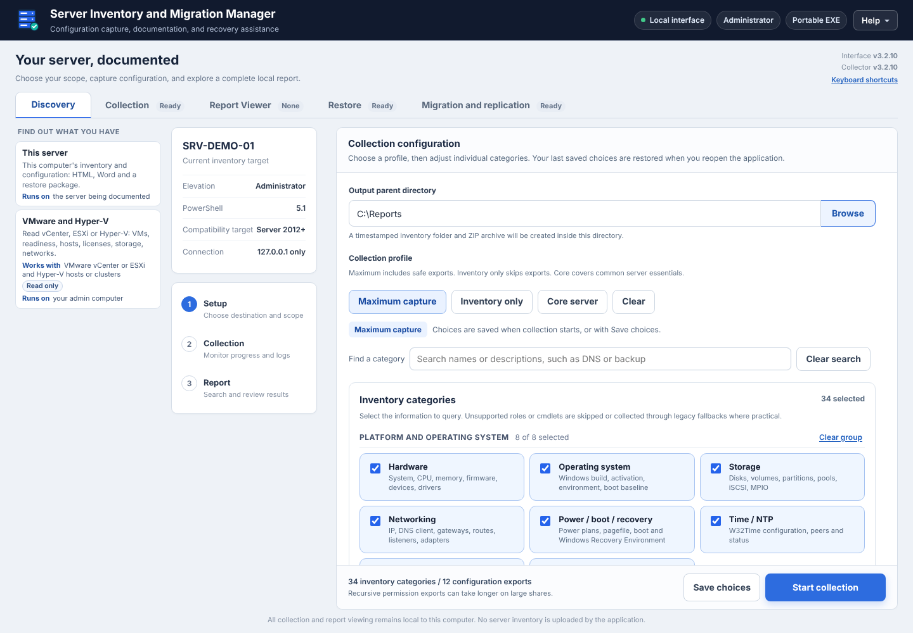
</p>

A portable **Windows x64 application** for collecting server inventory, exporting supported configurations, reviewing clear, searchable reports, restoring configuration, moving file shares to a new server, moving VMs off VMware or Hyper-V to Hyper-V, Scale Computing HyperCore, Nutanix AHV, Proxmox VE, Azure, Amazon EC2 or a physical server, converting virtual disks between VMDK, VHDX, VHD, qcow2 and raw, and replicating whole running servers to their new machines until cutover.

## Features

| Capture | Review | Keep working |
| --- | --- | --- |
| Choose inventory categories and optional configuration exports. | Start with an executive summary and visible collection issues. | Run a portable EXE with an isolated local browser interface. |
| Search grouped categories, use presets, and save or revert your preferred scope. | Search collapsed report sections and inspect supporting exports. | Keep settings, window placement, and shortcut targets through updates. |
| Collect available server-role details without treating missing roles as present. | Open HTML offline, print retained report data, or use Word/text outputs. | Choose when to download, install, and restart. |
| Export DHCP, NPS, print, IIS, DNS, firewall, registry and more for recovery. | See what a package can restore onto this server, and why anything cannot. | Restore chosen configuration with a rollback copy saved first. |
| Move file shares from an old server: files, NTFS permissions and share settings. | Check space, folders and accounts before copying, and verify after cutover. | Copy while users keep working, then cut over with one final copy. |
| Read a vCenter, ESXi or Hyper-V inventory and check each VM for Hyper-V, HyperCore, Nutanix AHV, Proxmox VE, Azure, EC2 or a physical server. | Plan waves, map networks and storage, check the new cluster's size or cloud quota, write a runbook. | Record a VM's settings before cutover, fix it up after, and compare before and after. |
| Convert a VMDK, VHD, VHDX, qcow2 or raw disk to any of them, merging snapshot chains, add VirtIO or server drivers so Windows starts on its new platform, and send it straight to ESXi, Hyper-V, Proxmox VE, Nutanix or HyperCore as a new VM. Copy this computer's own disks the same way (P2V). | See the format, size, data and chain of a disk before converting it. | Stop and continue a conversion, or repeat it to copy only what changed. |
| Put many VMware or Hyper-V VMs in one migration plan that seeds them from a start time and keeps them in sync on a schedule. | Watch every VM's state, progress, speed and time left, with tiles that filter to what is copying, in sync, testing or failed. | Test any VM on an isolated copy, then cut VMs over now or at a scheduled time, in wave order. |
| Install a replication agent on many servers at once and keep every disk copied to the new machine. | Watch each job's recovery point, alerts and log from **Replicate servers**, with summary tiles that filter to what needs attention. | Cut over now or at a set time: services stop, the last changes go across and every disk is checked. |

## Screenshots

### Capture

<table>
  <tr><td width="50%"><b>Category search without changing the selected scope</b><br>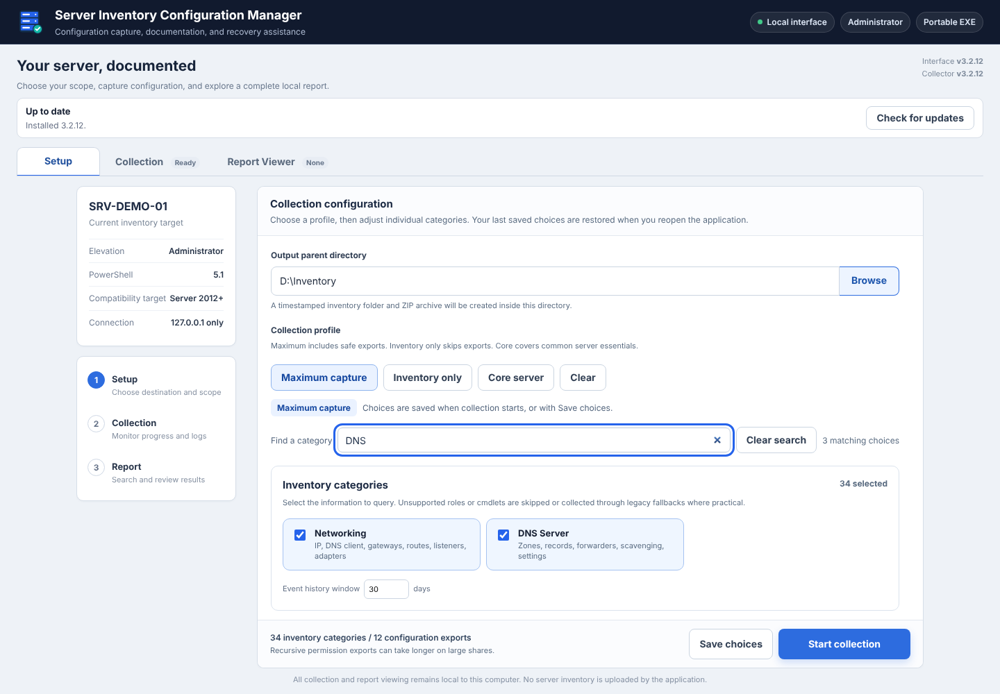</td><td width="50%"><b>Optional configuration exports</b><br></td></tr>
</table>

### Collection

<table>
  <tr><td width="50%"><b>Collection progress with a searchable live log</b><br>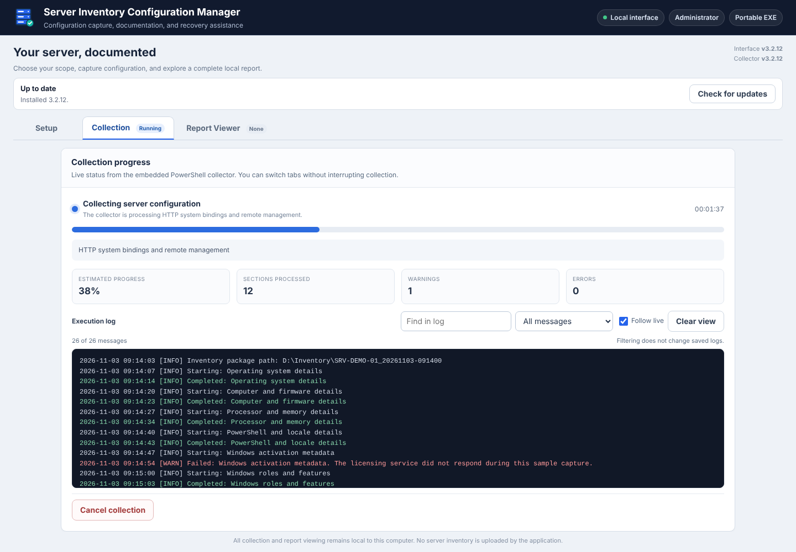</td><td width="50%"><b>Log filtered to warnings and errors</b><br>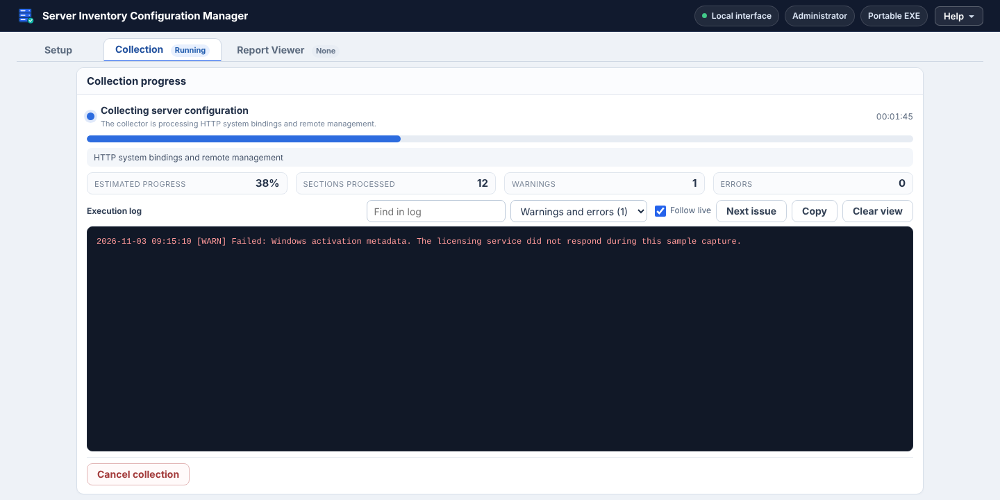</td></tr>
  <tr><td width="50%"><b>Bounded recursive permission export with Skip</b><br></td><td width="50%"><b>Validated collection ready to review</b><br></td></tr>
</table>

### Review

**HTML report executive summary**


### Restore

<table>
  <tr><td width="50%"><b>Choose what to restore, with each blocked item's reason</b><br>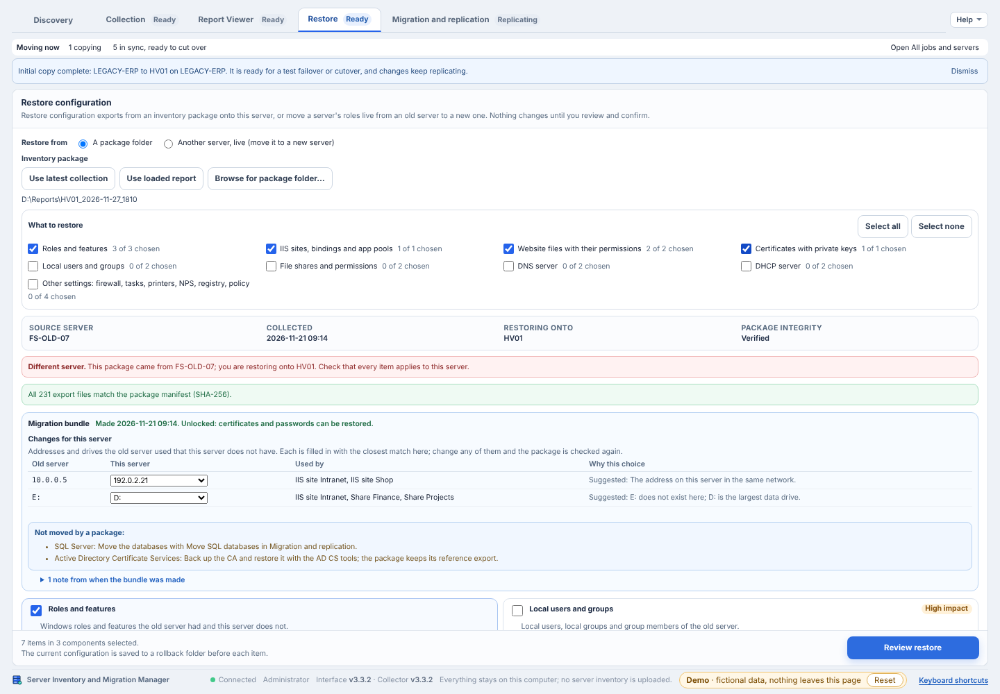</td><td width="50%"><b>Restore progress, one item at a time</b><br></td></tr>
</table>

### Migration and replication

<table>
  <tr><td colspan="2"><b>Guided migration: pick what you are moving and where to, then follow every step with the computer it runs on and a live check</b><br>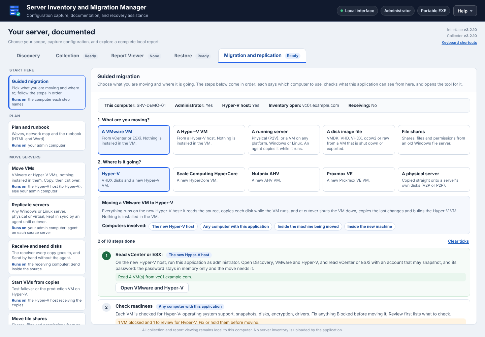</td></tr>
  <tr><td colspan="2"><b>The receiver shows who is connected and every copy arriving, with progress, speed and time left</b><br></td></tr>
</table>

### Move file shares

<table>
  <tr><td width="50%"><b>Choose shares and where they go, checked before anything is copied</b><br>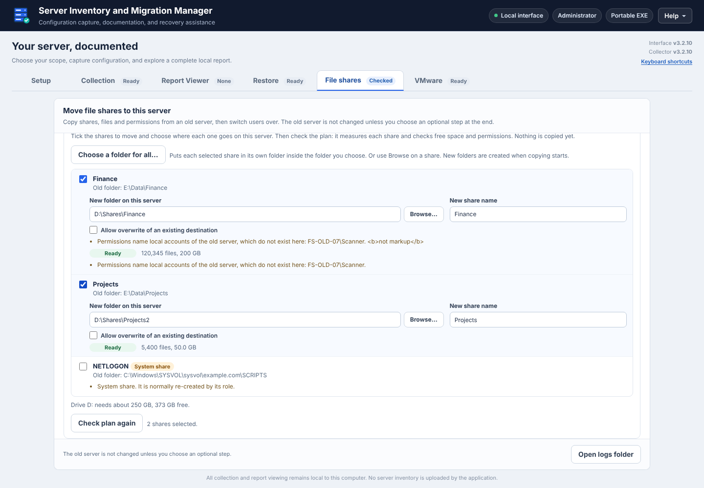</td><td width="50%"><b>Copy while users keep working; copy again for changes</b><br></td></tr>
</table>

### Move VMs off VMware

<table>
  <tr><td width="50%"><b>Every VM checked for the platform you choose, with what to fix first</b><br></td><td width="50%"><b>Waves, network and storage mapping, and cluster sizing</b><br></td></tr>
  <tr><td colspan="2"><b>Select any VM for its readiness, configuration, disks, networks and actions, with every host, cluster, datastore and network linked</b><br>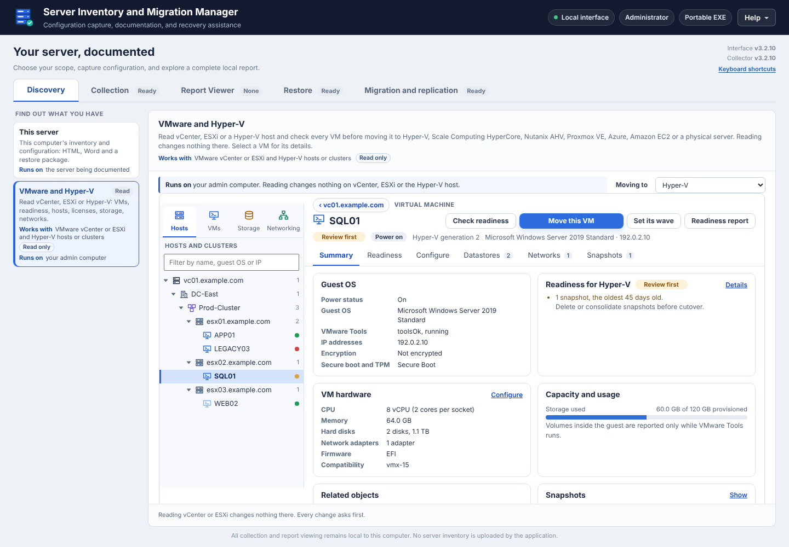</td></tr>
  <tr><td colspan="2"><b>Each cluster with its hosts' hardware, licensing, network, storage, services and VMs</b><br>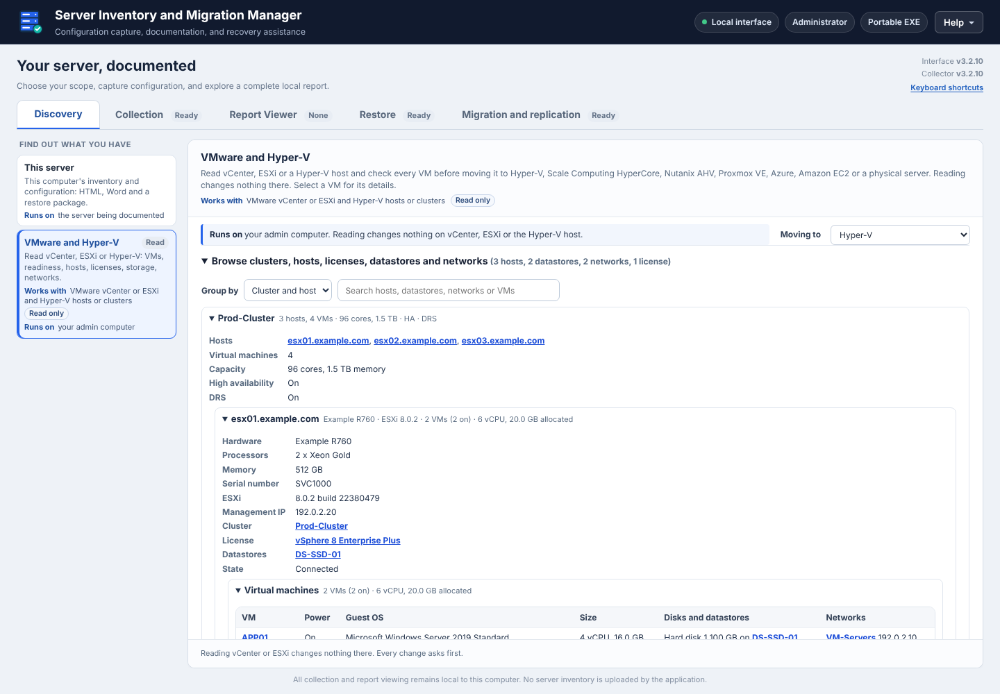</td></tr>
  <tr><td colspan="2"><b>Which computer runs what: the computer running the move, the VM being moved and the new machine, for the platform you choose</b><br>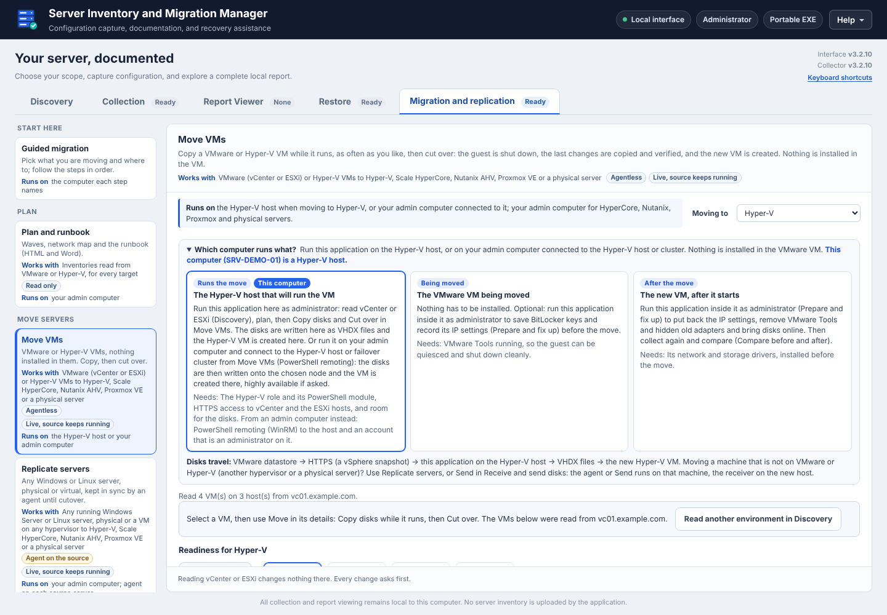</td></tr>
  <tr><td colspan="2"><b>Copy a running VM's disks to Hyper-V, then cut over</b><br>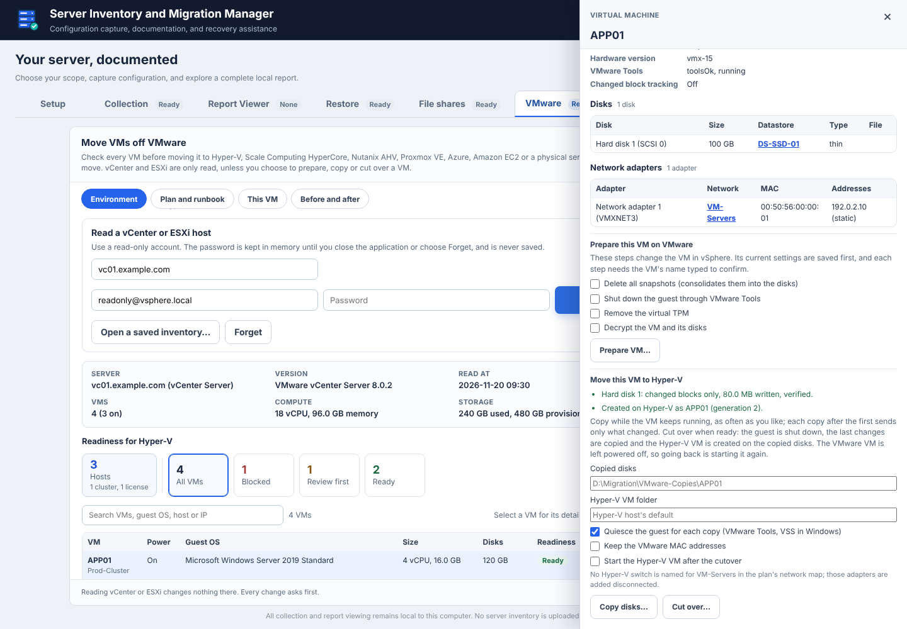</td></tr>
  <tr><td colspan="2"><b>Migration plans: many VMs seeded on a schedule, kept in sync, tested and cut over together</b><br>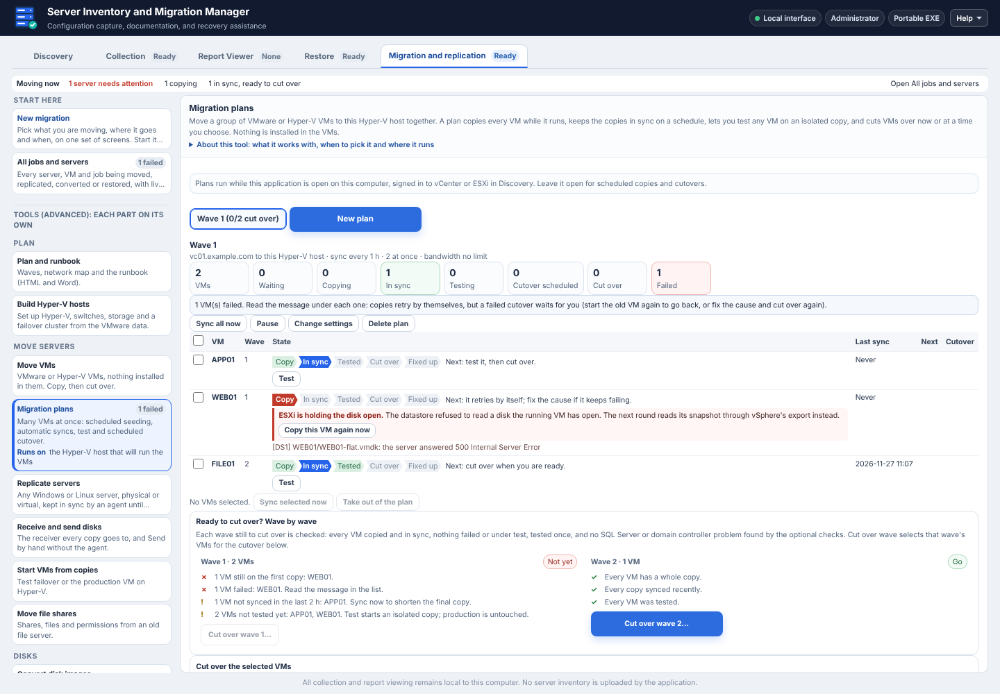</td></tr>
  <tr><td colspan="2"><b>On a failover cluster, choose a Cluster Shared Volume with room for the VM and make it highly available at the cutover</b><br></td></tr>
  <tr><td colspan="2"><b>Move to Proxmox VE, Nutanix AHV, Scale HyperCore or a physical server through receiver media</b><br>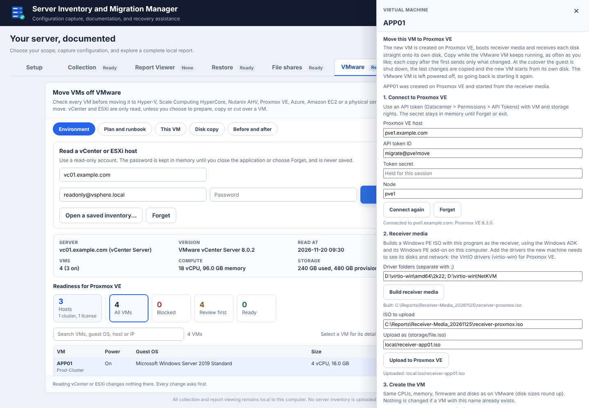</td></tr>
  <tr><td colspan="2"><b>Copy a whole machine's disks to another computer: choose which computer this is, then receive on the new host or send from the machine being moved</b><br></td></tr>
</table>

### Replicate whole servers

<table>
  <tr><td width="50%"><b>Install the agent on many servers and see every alert in one place</b><br></td><td width="50%"><b>Each server's jobs with their recovery point, rounds and status</b><br>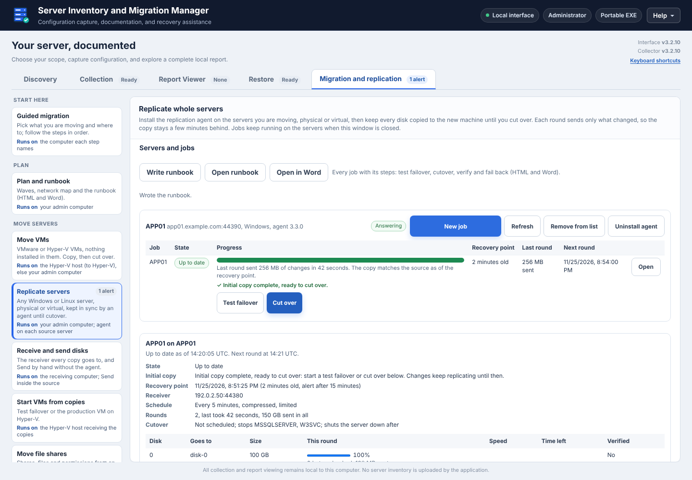</td></tr>
</table>

### Convert disks

**Convert a VMDK, VHD, VHDX, qcow2 or raw disk, with its snapshot chain merged and every chunk checked**

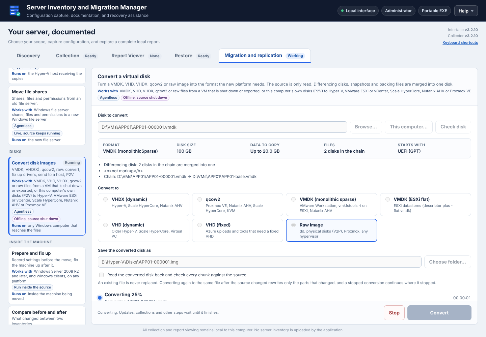

**Send a converted disk straight to Proxmox VE, Nutanix, HyperCore, ESXi or Hyper-V as a new VM**

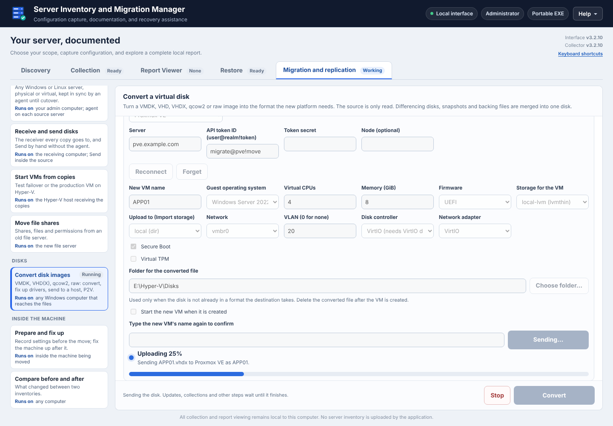

### Keep working

**Update available with release notes; you choose when to download**


## Download

Get the maintained **Windows EXE** from [the current release](https://github.com/TechSavage1989/Server-Inventory-Configuration-Manager/releases/latest), with its checksum and release notes. The historical PS1 application is not the current product.

Direct links: [Download Windows EXE](https://github.com/TechSavage1989/Server-Inventory-Configuration-Manager/releases/latest/download/Server-Inventory-Configuration-Manager.exe) · [Releases & checksums](https://github.com/TechSavage1989/Server-Inventory-Configuration-Manager/releases)

## Requirements

- **Windows x64**, with Windows Server 2012+ as the compatibility target. Older Windows/PowerShell and individual server roles still require field validation; see [docs/VALIDATION.md](docs/VALIDATION.md).
- **Built-in Windows PowerShell** for inventory collection and the permissions required to query/export the selected scope. Run with administrator rights for administrator-only data.
- **Microsoft Edge or Chrome**, version 109 or later (109 is the last release for Windows Server 2012 and 2012 R2). Where company policy turns off guest browsing, or no supported browser is installed, the app opens in its own built-in window instead. That needs the **Microsoft Edge WebView2 Runtime**, which is part of Windows 10 and 11 and a separate free install from Microsoft on Windows Server 2012–2019. The app never changes browser policies.
- A display of **800×600 or larger**. On small screens the header and panels become compact so the settings, log and report stay reachable.
- A writable application location and output folder. Go, Python, and Node.js are **build tools**, not normal application requirements.

## Getting started

1. Download **`Server-Inventory-Configuration-Manager.exe`** from the current [release](https://github.com/TechSavage1989/Server-Inventory-Configuration-Manager/releases/latest). Use its checksum file if you want to verify downloaded bytes.
2. Keep the EXE in a permanent writable folder, then launch it with the permissions appropriate to your authorized server work.
3. In **Discovery → This server**, choose the **Output parent directory**. Pick **Inventory only**, **Core server**, or **Maximum capture**, then review the individual categories and optional exports.
4. Use **Save choices** to remember the configuration, or start collection to save and run it. In **Collection**, search the log, filter warnings/errors, or pause **Follow live** to inspect earlier output.
5. Open **Report Viewer**, inspect collection failures/recovery gaps first, then search the details and supporting files in your output folder.

> **Protect your exports.** Inventory and configuration files can contain sensitive infrastructure information. Review the scope and sensitive-data options before collecting; store and share the output securely. Configuration exports and recovery references are not a substitute for a tested backup, and no restore runs unless you choose it on the **Restore** tab and confirm it.

**Coming from an older version?** The original v3.0.10 EXE and historical v3.1.0 PS1 application need one manual download of the maintained EXE. The PS1 application is historical—not the current product or build baseline. Existing executable updates preserve the installed path, including custom filenames.

## How to use

Setup shows the selected profile and exact inventory/export counts. Inventory categories are grouped (platform, workloads, identity and network roles, file/print/backup, security and diagnostics), each with a running count and a one-click Select all / Clear group. Categories with an enabled configuration export carry a **+ export** tag. Search by category name or description without altering your selections; optional exports expand when needed and empty groups hide. Unchecking an inventory category also clears its dependent export. Saved safe choices return at the next launch, and **Revert to saved** undoes unsaved edits. Sensitive permission and NPS full export must be selected again each session.

Use the Collection log's search and severity filter to focus on issues; the filter shows live warning/error counts. **Next issue** (or `N`) steps through warnings and errors, clicking the Warnings or Errors tile filters the log, and **Copy** copies the messages currently shown. Scrolling back pauses live following; enable Follow live to return to the newest output. Filtering and Clear view do not alter saved diagnostic files. After a run, **Open output folder** and **Show ZIP archive** go straight to the package and bring the folder window to the front. The window title shows progress (for example `42% Collecting`) so you can follow a run from the taskbar.

In the Report Viewer search, `Enter` moves to the next match and `Shift+Enter` to the previous one (`F3` / `Shift+F3` also work); `Esc` clears the search.

**Keyboard shortcuts** (press `?` or choose **Help → Keyboard shortcuts**): `Alt+1` to `Alt+5` switch tabs (Discovery, Collection, Report Viewer, Restore, Migration and replication), `/` or `Ctrl+K` focuses the current tab's search, `Ctrl+S` saves choices and `Ctrl+Enter` starts collection from **Discovery → This server**.


New HTML reports open on an executive summary: the server profile (operating system, Windows activation status, IPv4 addresses, default gateway, DNS servers, DHCP or static addressing, and more) and detected roles, collection health with links to each collection issue and recovery gap, and inventory counts that jump to their datasets. Items that need attention stay expanded at the top; routine datasets expand on demand. Each section starts with a contents panel that groups its datasets under their headings, shows row counts and marks datasets with failures or warnings. Datasets that returned no data are gathered into one collapsed **No data collected** group instead of a long run of empty entries. Name/value lists and single-record tables read as property sheets. Search includes collapsed sections and raw text. Hover any value and choose **Copy** to copy just that value; **Copy table**, **Copy section** and **Copy full report** copy more, and **Copy path** in the Report Viewer copies the report file location. The report uses the full window width. Printing includes all rows retained by the report snapshot; truncation notices still point to complete supporting exports.

In the report, the section menu shows a badge counting failed, high-severity and warning items so you know where to look first, and it highlights the subsection you are reading. A table with problems shows **errors** and **warnings** buttons in its header: click one to jump to the affected row, and click again for the next. Numeric columns are right-aligned, and each section has **Print section** alongside Print all. The report stays legible on 800 × 600 and 1024 × 768 screens, standalone or in the Report Viewer. Pressing `Enter` again in report search moves to the next match (`Shift+Enter` goes back, `Esc` clears) and the message names the section. `[` and `]` move between sections, `/` focuses search, and a **Back to top** button appears on long sections.

HTML reports work offline without external fonts, libraries, or image services. Existing reports remain readable in the viewer; **generate a new report to get the redesigned layout**. Word, text, and raw outputs remain available.

## Migration and replication

Every migration and replication tool lives in one **Migration and replication** tab (Alt+5). The list on the left groups them and says what each is for and which computer it runs on; reading environments lives separately in **Discovery** (Alt+1), beside **This server**.

| Group | Tool | What it does | Runs on |
| --- | --- | --- | --- |
| Start here | **Guided migration** | Pick what you are moving and where to; every step in order, with checks that stop you on the wrong computer, without a receiver or short of space. | The computer each step names |
| Plan | **Plan and runbook** | Waves, network map, sizing and the runbook (HTML and Word). | Your admin computer |
| Move servers | **Move VMs** | Copy a VMware or Hyper-V VM while it runs, then cut over. | The Hyper-V host, or your admin computer connected to it (to Hyper-V); otherwise your admin computer |
| Move servers | **Replicate servers** | Keep any Windows or Linux server copied until cutover, through an agent on the source. | Your admin computer; the agent on each source |
| Disks | **Receive and send disks** | The receiver every copy goes to, receiver media, and Send by hand. | The receiving computer; Send inside the source |
| Disks | **Start VMs from copies** | Test failover and the production VM on Hyper-V. | The Hyper-V host receiving the copies |
| Disks | **Move file shares** | Shares, files and permissions to a new file server. | The new file server |
| Disks | **Convert disk images** | VMDK, VHD, VHDX, qcow2 and raw, with Windows fix-ups and Send to a host. | Any computer that reaches the files |
| Any computer, nothing installed in the machine | **Prepare and fix up**, **Compare before and after** | Record settings, fix up the new machine (from vCenter, PowerShell Direct or PowerShell remoting; inside the machine as a fallback), and compare two inventories. | The Hyper-V host or your admin computer; any computer |

**Guided migration** starts with *what are you moving* (a VMware VM, a Hyper-V VM, a running server, a disk image or file shares) and *where to* (Hyper-V, Scale HyperCore, Nutanix AHV, Proxmox VE, a physical server or vSphere). It then lists each step with the computer it runs on, a live check of what this computer can see, and a button that opens the right tool. A step that would go wrong here (for example copying to Hyper-V from a computer that is not the Hyper-V host, or a host without room for the VM) is blocked with the reason. Ticks are remembered per flow.

**Where copies land on Hyper-V.** On a Hyper-V host, copies and the receiver default to the host's own virtual hard disk folder. In a failover cluster, the VM's **Move** section offers each Cluster Shared Volume (`C:\ClusterStorage\...`) with its free space for both the disks and the VM folder, a copy that does not fit is refused before it starts, and **Make it highly available in the failover cluster** (off unless ticked) adds the new VM as a clustered role at the cutover. If adding the role fails, the VM is still created and the reason is shown.

**What each tool works with.** Every tool in Migration and replication says which systems it works with and how: for example, **Move VMs** takes VMware (vCenter or ESXi) or Hyper-V VMs to Hyper-V, Scale HyperCore, Nutanix AHV, Proxmox VE or a physical server, agentless and live; **Replicate servers** takes any running Windows Server or Linux server, physical or virtual, with an agent on the source; **Convert disk images** works offline from shut-down or exported disks. In **Guided migration**, **Ways to do this** lists only the ways that fit the source and target you chose, marks the one the steps follow, and switches to another's steps in one click.

**Finding receivers.** Instead of typing the address, choose **Find receivers** under the receiver address in Send, a replication job or a VM's Move section. Every receiver on the same network that allows it answers (Receive's **Let senders on this network find this receiver** is on by default) with its name, address, what it holds, free space and a short certificate fingerprint; for another subnet, type that one computer's name or IP and search again. **Use this receiver** fills the address and thumbprint. For the pairing code, choose **Ask to pair**: the receiver's Receive panel shows the request with a check number, and once you allow it there (only when both screens show the same number) the code fills in by itself. Receiver media has no screen to allow requests on, so type the code shown on its console. The search uses UDP port 44379 and never scans addresses; when **Allow this port through Windows Firewall** is ticked, the receiver opens that port too until it stops.

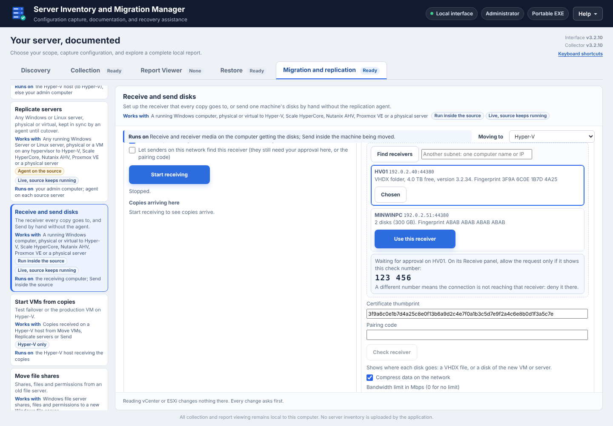

**Connection details.** The receiver's address, thumbprint and pairing code each have a **Copy** button, and **Copy all connection details** copies all three; pasting that block into any of the three fields on the sending side (Send, a replication job or a VM's Move section) fills all of them.

**Live progress.** The receiver lists the senders connected to it and every copy arriving, and Send and each VM's Move section list the disks going out: where each comes from and goes to, percent done, data read, written and on the network, speed, time left, and whether it finished, was verified or failed. Replication job details show the same per disk for the running round. Summary tiles, such as the replication counts (Behind, Failing, Not answering and so on), are buttons: each filters the list to what it counts and says why and what to do next.

## Restore configuration

The **Restore** tab puts configuration from an inventory package back onto a server: after a failed change, or onto a rebuilt or replacement server. Choose the package folder (your last collection or the loaded report's package are one click away), and the app checks it against its `SHA256-Manifest.csv` and against this server. Each component then shows what it would restore, or exactly why it cannot (for example, the role is not installed, the export was not selected when the package was collected, or a file changed after collection).

| Component | What is restored | How |
| --- | --- | --- |
| DHCP Server | Scopes, options, reservations, policies and leases; server options, classes and option definitions | `Import-DhcpServer` (on Windows Server 2016+, scopes only, with server settings applied separately because the import's NAP settings are refused) |
| Network Policy Server | RADIUS clients, shared secrets and policies (only from packages collected with sensitive exports allowed) | `Import-NpsConfiguration` |
| Printers and print drivers | Print queues, drivers, ports and processors | PrintBRM |
| IIS | Sites, bindings, application pools, applications | `appcmd restore backup` |
| DNS | Primary zones missing from this server, with their records | DNS Server cmdlets |
| Group Policy | Domain GPOs from Backup-GPO (nothing selected by default) | `Restore-GPO` / `Import-GPO` |
| Windows Firewall | All rules and profile settings | `netsh advfirewall import` |
| Certificates | Public certificates missing from their original store | `Import-Certificate` |
| Scheduled tasks | Custom tasks (not tasks that store a password) | `Register-ScheduledTask` |
| Share permissions | Complete recursive NTFS permission saves | `icacls /restore` |
| Registry settings | Exported HKLM branches such as TLS, Remote Desktop and SMB (nothing selected by default) | `reg import` |
| Local security policy | Password, lockout and audit policy, security options, user rights | `secedit /configure` |

Restoring needs administrator rights. Review each component's warnings, select the items you need, and type the server's name to confirm. Components run in a fixed, safe order and the restore stops at the first failure. Before each item changes anything, its current configuration is saved to a rollback folder under `%LOCALAPPDATA%\Server Inventory Configuration Manager\Restore-Rollback\`, with an `UNDO.txt` in each component folder; **Open rollback folder** goes straight to it. **Stop after this item** never interrupts an item part way through. Collection, updates and closing the app wait until a restore finishes.

Device drivers other than print drivers, Active Directory, SQL Server, RRAS, AD CS and Hyper-V are not restored; the package keeps their reference exports. Private keys were never exported, so certificates that need one must come from a protected PFX. Restoring onto a different server shows extra warnings for each component.

## Move file shares to a new server

**Move file shares** (in **Migration and replication**) moves file shares from an old server to the server you run the application on. Run it as administrator on the **new** server. The old server is reached with the account you are signed in with, or with another account you enter under **Connect as**. Either way, that account must be an administrator on the old server, normally a domain account. A local account with the same name and password is not enough, because Windows removes administrator rights from local accounts over the network. If the old server refuses access, it opens the **Connect as** fields for you. The password is kept in memory only, until you close the application or choose Start over, and is never saved or written to a log. The old server must allow remote management: WinRM (on by default since Windows Server 2012) or the Windows Management Instrumentation firewall rules.

1. **Connect:** type the old server's name and, if needed, choose **Another account** under Connect as and enter a user name (DOMAIN\admin or admin@domain) and password. Every share except administrative shares (C$, ADMIN$, IPC$) is listed with its folder and permissions. System shares such as NETLOGON or print$ are shown but not ticked.
2. **Choose shares:** tick the shares to move and choose the new folder and share name for each (defaults: `D:\Shares\<name>` on the drive with the most free space, same share name). **Browse** opens the Windows folder picker for one share (with Make New Folder), and **Choose a folder for all** puts every selected share in its own folder inside the folder you pick. Folders that don't exist yet are created when copying starts; Windows, Program Files, ProgramData and user profile folders are refused. **Check plan** measures each share and checks that the old folder can be read, the new folder is empty, there is enough free space for the estimated changed files, and which permissions name accounts that won't exist here. Existing destinations are blocked unless you tick **Allow overwrite of an existing destination** for that share. The choice is per share and stays with its saved plan.
3. **Copy:** copies files, folders, timestamps, attributes and NTFS permissions with Robocopy while users keep working. The new top folder gets the old top folder's permissions too, including those it inherited on the old server, so access works the same. **Copy again** as often as you like; each pass copies only what changed and removes what was deleted on the old server. By default a copy refuses a folder already holding unrelated files. **Allow overwrite** intentionally permits a mirror into that folder, replacing changed files and deleting destination-only files. Before each such copy, type this server's name to confirm; a share-file backup is not created.
4. **Cut over:** ask users to stop using the old shares, then type this server's name to confirm. A final copy runs, the shares are created or updated here with the old share settings and share permissions, the old and new folders are compared, and each new share is opened through its network path (`\\<this server>\<share>`) to confirm it works. When overwrite is enabled, an existing share with the same name can be replaced even if it points to a different folder. Current share settings and permissions are saved under the migration logs before replacement. Users connected to the replaced share will be disconnected. The old destination folder is not deleted by the share-mapping change. SYSVOL, NETLOGON and other role-managed shares need a separate recovery plan: replacing them can disrupt Windows services, Active Directory and Group Policy.

After cutover, three optional steps help users find the new shares:

- **Make old shares read-only**, so nobody keeps saving to the old server. Their previous permissions are saved and **Undo** puts them back.
- **Find DFS links** that point at the old server, with the new path for each (domain servers with the DFS Management tools).
- **Give this server the old server's name**, so existing mapped drives and shortcuts keep working. This is only offered once the old server no longer answers on the network. It adds the name with `netdom` (DNS and Active Directory), needs Domain Admin rights and a restart, and can be undone with the command saved in the logs folder.

Logs and the saved plan are kept under `%LOCALAPPDATA%\Server Inventory Configuration Manager\Migrations\<old server>\`, so a migration can continue after the application is closed. The old server is never changed except by the optional read-only step. Collection, restore, updates and closing the application wait while a migration step runs.

## Move VMs off VMware

**Move VMs** (in **Migration and replication**, with the inventory read in **Discovery → VMware and Hyper-V**) helps move virtual machines from VMware vCenter or ESXi to another platform. Choose it under **Moving to**; every check, the sizing and the runbook follow it:

| Moving to | Drivers the guest needs | Usual copy tool | Sizing |
| --- | --- | --- | --- |
| Hyper-V | Built into current Windows | System Center VMM, Veeam or StarWind V2V | New cluster |
| Scale Computing HyperCore | VirtIO (Scale guest tools) | This application (receiver media), or Scale Computing's migration tools | New cluster |
| Nutanix AHV | Nutanix VirtIO | This application (receiver media), or Nutanix Move | New cluster |
| Proxmox VE (KVM) | virtio-win | This application (receiver media), or the Proxmox VE ESXi import wizard | New cluster |
| Microsoft Azure | Hyper-V (built in) and the Azure VM Agent | Azure Migrate | Subscription quota |
| Amazon EC2 | AWS ENA and NVMe | AWS Application Migration Service | Account quota |
| Physical server (V2P) | The server vendor's storage and network drivers | This application (receiver media), or a bare-metal restore to different hardware | One server per VM |

The application changes nothing in vCenter or ESXi unless you choose **Prepare source** or a **Move** step for one VM. It copies disks itself to Hyper-V, Scale HyperCore, Nutanix AHV, Proxmox VE and physical servers; for Azure and EC2 use the copy tool for your platform, or export the disk and convert it in **Convert disk images** (for example a VMDK into a VHD or raw image). The **Prepare and fix up** checks run on any Windows computer, so they also help with physical-to-virtual and virtual-to-virtual moves from other platforms.

- **Which computer runs what:** a move involves up to three computers, and the panel at the top of each tool (**Which computer runs what?**) shows them for the platform chosen under **Moving to**, with what each one needs and the path the disks take. For **Hyper-V**, run the application on the Hyper-V host that will run the VM: the disks are written and the VM is created there, and **Copy disks** and **Cut over** are refused on any other computer. For **HyperCore, Nutanix AHV, Proxmox VE and physical servers**, run it on your admin computer or a jump box that can reach vCenter, the platform and the new machine: the new VM or server boots the receiver media and the disks pass through your admin computer. Nothing has to be installed in the VMware VM for either; run the application inside it only for the optional **Prepare and fix up** steps. **Receive and send disks** is the exception for machines not on VMware: there the application runs on both the machine being moved (Send) and the receiving computer (Receive), and **Which computer is this?** shows only that computer's side. Each move panel and step is labelled with where it runs, and the runbook opens with the same **Where each part runs** table.
- **Environment:** type the vCenter or ESXi host name and an account. A read-only account is enough. The password is kept in memory only, until you close the application or choose **Forget**, and is never saved. If Windows does not trust the server's certificate, the tab shows its SHA-256 thumbprint and reads the server only after you choose **Trust this certificate**. Every VM is then checked and marked **Ready**, **Review first** or **Blocked**, with what to fix and how: unsupported or old guest systems, Hyper-V generation and Azure disk limits, drivers the platform needs, BIOS firmware on modern servers, snapshots, shared or RDM disks, independent disks, encryption, vTPM, passthrough and USB devices, connected ISOs, VMware Tools and static IP addresses. vCLS agents, the vCenter appliance and nested ESXi hosts are marked **Not moved** and left out of the plan, backup snapshots name the backup software that made them, and Windows domain controllers get a warning to move them cold. It is a full discovery of the environment as well: for every host, the hardware, serial number, BIOS, CPU and memory use, physical network adapters, virtual switches, VMkernel ports, storage adapters (with FC WWPNs and iSCSI names), storage devices, DNS, gateway, NTP, services, installed software packages (VIBs), alarms, configuration issues and certificate expiry; the licenses with edition, usage, expiry and what each is assigned to (keys show only their first and last group); and cluster EVC, HA, DRS and vSAN settings, resource pools, vApps and distributed switches. The cards above the VM list count the hosts and the VMs by readiness; they add up to **All VMs**, and VMware's own system VMs are counted as **Not moved**. Select a VM (click it, or use the arrow keys) to open its details beside the list: readiness for the chosen platform and the others, configuration, disks with their datastores, network adapters, snapshots, and actions such as **Prepare on VMware** and **Set its wave**. Every host, cluster, datastore, network and license name there opens its own details, and **Back** returns. The **Hosts** card opens **Browse clusters, hosts, licenses, datastores and networks** under the list, which starts with what needs attention, such as a license or host certificate that expires soon. Group by cluster and host to see each cluster's HA and DRS settings, licensing, hardware and datastores, and in each host its VMs, hardware and firmware, management and time settings, license, network, storage, services, software packages and alarms; by datastore to see the hosts that mount it and every VM disk on it with its file; or by network to see each VM adapter with its addresses. Search narrows all three. The inventory, a readiness report and a discovery report (HTML, with every host's VMs, every datastore's disks and every network's VMs linked to each other), and CSV files for VMs, disks, network adapters, snapshots, hosts, clusters, datastores, networks, licenses and each host's network, storage, services and software are written to a `VMware_<server>_<time>` folder in your output folder. **Open a saved inventory** plans from that folder later, away from the customer's network.
- **Prepare source:** while the session is still connected, a VM's details offer to remove all its snapshots, shut down the guest through VMware Tools (never a forced power-off), remove its virtual TPM and decrypt the VM and its disks, which VMs encrypted for a vTPM need before any copy tool can read them. Only the steps the VM needs are ticked, you type the VM's name to confirm, and the VM's settings are saved to `%LOCALAPPDATA%\Server Inventory Configuration Manager\VMware\<server>\Prepare\` first. The account needs rights to change the VM, and decrypting needs vCenter's key provider. A VM whose own files are encrypted only for its virtual TPM (its disks are plain) needs no decrypting: its disks copy as they are, and readiness says so instead of blocking it; only VMs with encrypted disks are Blocked, with two ways out (Replicate servers, whose agent reads the disks decrypted, or decrypting here). Before a Windows VM with BitLocker loses its vTPM, use **Save keys and suspend** under **Prepare and fix up**, from this computer over PowerShell remoting: it saves the recovery keys to a file in your output folder and suspends protection so Windows still starts without the TPM.
- **Move to Hyper-V:** run the application on the Hyper-V host, read the inventory there and choose Hyper-V under **Moving to**. A VM's details then offer **Copy disks**: while the VM keeps running, vCenter takes a snapshot named "Server Inventory and Migration Manager replication", each disk is copied into a VHDX file (only the used areas the first time, then only the blocks that changed, using VMware changed block tracking, which is turned on for the VM if it is off) and the snapshot is removed. Copy as often as you like; a stopped copy resumes. **Cut over** shuts the guest down through VMware Tools, copies the last changes, checks every disk against its recorded hashes and creates the Hyper-V VM on the copied disks: generation 2 with Secure Boot and a virtual TPM where the VMware VM used EFI and a vTPM, the same CPUs and memory, the boot disk first, and one adapter per VMware adapter on the Hyper-V switch named in the plan's network map (with its VLAN, and the VMware MAC address if you choose). The VMware VM is left powered off and otherwise unchanged, so going back is starting it again. Both steps ask you to type the VM's name. VMs with other snapshots, encrypted disks or raw device mappings are refused until Prepare source or the storage team deals with them. Copied disks go to `VMware-Copies\<VM>` in your output folder unless you choose another folder; records of each vSphere change are saved under `%LOCALAPPDATA%\Server Inventory Configuration Manager\VMware\<server>\Move\`. Before each copy the VM's IP settings, gateways and DNS servers are recorded from vCenter (what VMware Tools reports), so nothing runs inside the VM. After the cutover, **Prepare and fix up** on the Hyper-V host reaches the new VM through PowerShell Direct, with no network, and puts them back.
- **Migration plans (many VMs at once):** run the application on the Hyper-V host that will run the VMs, read vCenter, ESXi or a Hyper-V host in **Discovery**, then open **Migration and replication → Migration plans** and choose **New plan**. Pick the VMs (waves and the network map come from **Plan and runbook**), when the first copies start, how often each VM syncs (15 minutes to a day), how many copy at once (1 to 4) and a bandwidth limit for business hours and for other times. The plan then copies every VM while it runs, exactly as **Copy disks** does for one VM, and keeps each copy up to date on its interval; a failed round is retried after 5, 10 and 20 minutes. Each VM shows its state, progress, speed, time left, last and next sync, and the tiles at the top (Copying, In sync, Testing, Cutover scheduled, Cut over, Failed) filter the list. **Test** makes `NAME-TEST` on differencing disks with its network disconnected (or on a test switch you choose), so the copies and production are untouched; syncs for that VM wait until **End test** removes it. Select VMs and **Cut over now** or **Schedule cutover** for your maintenance window, typing the plan's name: each guest is shut down through VMware Tools or the Hyper-V shutdown service, its last changes are copied and verified, and the Hyper-V VM is created (highly available on a Cluster Shared Volume if you ask). VMs cut over one by one in wave order; one failing never stops the others, a VM whose final copy fails is never created, and a failed cutover waits for you instead of retrying. By default (untick it to leave the old VM as it is), after a successful cutover the old VMware VM's network adapters are set to not connect (their settings are saved first), so starting it by mistake cannot clash with the new VM. Plans are saved without passwords and run only while the application is open on the host and signed in to vCenter or ESXi; after a restart a plan waits and says why until you sign in again. This has not yet been tried against a real vCenter and Hyper-V host; try a test plan first.
- **Move to Scale HyperCore, Nutanix AHV, Proxmox VE or a physical server:** choose the platform under **Moving to** and open a VM's details while the vCenter session is connected. The move has five steps. **1 Connect** to the platform (HyperCore and Prism Central with a user name and password, Proxmox VE with an API token); the secret is kept in memory only. **2 Receiver media** builds a Windows PE ISO that runs this application as a receiver, using the Windows ADK and its Windows PE add-on installed on this computer (the application never downloads Windows PE) and the driver folders you choose, such as the VirtIO drivers for KVM platforms or the server vendor's drivers; **Upload** then puts the ISO on the platform under a new name. **3 Create the VM** makes a new VM with the same CPUs, memory, firmware (UEFI with Secure Boot and a virtual TPM where the VMware VM had them), disks rounded up to whole sizes, and one adapter per VMware adapter on the network and VLAN you choose, and starts it from the receiver media; nothing is changed if a VM with that name exists. For a physical server, write the ISO to a USB stick or the server's virtual media and boot from it instead. **4 Receiver:** the receiver's console shows its address, a pairing code and its certificate thumbprint; type them in and **Check** shows which disk each VMware disk goes to. The receiver only writes to blank disks and never to the disk it runs from. **5 Copy and cut over** works as for Hyper-V, over an encrypted connection pinned to that thumbprint: copy while the VM runs, as often as you like, then **Cut over** shuts the guest down through VMware Tools, copies and verifies the last changes, and powers the new VM off, sets it to boot from its own disk and starts it. On a physical server, stop the receiver, remove the boot media and start the server. Creating, copying and cutting over ask you to type the VM's name. These platform connections are built from each vendor's public API documentation and have not yet been tried on real HyperCore, Prism Central or Proxmox VE systems; try a test VM first.
- **Receive and send disks:** copies whole disks between two computers running this application, for a machine on any hypervisor or a physical server (P2V). Choose **Which computer is this?** on each computer to see only its side. On the new host, **Receive** starts a receiver that saves each disk as a VHDX file (in `VMware-Copies\Received` in your output folder unless you choose another folder) and shows its address, certificate thumbprint and a pairing code; it can allow its port (44380 unless you choose another) through Windows Firewall until it stops. On the machine being moved, run the application as administrator, choose **Find disks**, tick the disks, and type the receiver's address, thumbprint and code into **Send**. Each NTFS or ReFS volume is read from a new Volume Shadow Copy (deleted afterwards), so the copy is consistent while the machine keeps running, and the connection only works with the receiver whose exact certificate you typed. Send again before cutover to send only what changed, then shut the machine down, send a last time and attach the VHDX files to the new VM. To send straight onto the disks of a new HyperCore, Nutanix, Proxmox or physical machine that booted receiver media, choose **Check receiver** and pick which of its disks each disk goes to. **Compress data on the network** sends less over slow links, and a **Bandwidth limit** in megabits per second keeps the copy from filling the line. A new code and certificate are made each time the receiver starts; the code is never saved or logged.
- **Plan and runbook:** for a cluster platform, describe the new cluster (nodes, cores, memory, storage, nodes kept free) to check that the VMs fit. For Azure and EC2 the tab totals the vCPUs and disk space to check against your quota, and for physical servers it lists what each server needs. Name the network and VLAN each VMware network becomes and where each datastore's disks go. Put VMs in waves, hold blocked ones and exclude anything not moving; **Suggest waves** puts blocked VMs on hold, powered-off VMs first and the rest in waves of the size you choose. **Write runbook** writes `Migration-Runbook.html` and the same runbook as a Word document, `Migration-Runbook.docx`, opening with **Where each part runs** (which computer runs the move, what the VM being moved and the new machine need) and then before, cutover, check and roll-back steps for every VM in each wave. Every step has a real check box: in the HTML runbook, ticks are saved in that browser and each VM, wave and the whole runbook show how many steps are done (**Print** prints it with the ticks); in Word, click a box to tick it and save the document. The steps use this application's own **Move**, **Receive and send disks** and **Convert disk images** where they apply, and `Migration-Plan.csv`. The plan is saved per vCenter under `%LOCALAPPDATA%\Server Inventory Configuration Manager\VMware\`.
- **Prepare and fix up, nothing installed in the machine:** choose **Which machine?**: a VM on this Hyper-V host or on the connected Hyper-V host (PowerShell Direct, no network needed, Windows 10 or Server 2016 and later), a computer over the network (PowerShell remoting), or this computer (run the application inside the machine, as before). Type an administrator account of the machine; it stays in memory only. A VMware VM's IP settings can also be recorded from vCenter with no sign-in at all, and Move VMs does that by itself before each copy. It shows which platform it runs on now (VMware, Hyper-V, Azure, EC2, Nutanix, Proxmox or KVM, HyperCore or physical). **Record settings** (before the move, on VMware) saves its IP settings (addresses, gateways, DNS, WINS, VLAN), disks, drivers and running services, and checks the drivers the chosen platform needs, BitLocker, the SAN policy and activation. After the VM starts on the new platform, **Check what needs fixing** compares it with the recording without changing anything, and the same tab then puts the recorded IP settings on the new network adapters (the current settings are saved first, and **Undo** puts them back), removes hidden network adapters left by the old hardware, brings offline data disks online (never the boot or system disk), removes VMware Tools and activates Windows. **Activate Windows** names the license channel recorded before the move and what it needs now. KMS and Active Directory activation renew by themselves on the network. A MAK activates again and uses one of its activations. A retail key may need phone activation. An OEM license belongs to the old hardware and cannot move. On a Hyper-V host running Windows Server Datacenter, **Use the AVMA key** fills in Microsoft's published Automatic Virtual Machine Activation key (Windows Server 2025); for other versions, paste the key from Microsoft's page. A test failover VM has no network and shows as not activated, which is expected: do not activate it. Each of these asks you to type the computer's name. It also lists services that ran before the move and do not run now. The recording is kept under `%LOCALAPPDATA%\Server Inventory Configuration Manager\Guest-Migration\`, with a copy in your output folder, and **Load a recording** brings in a copy from elsewhere.
- **Before and after:** collect an inventory of the server in **Discovery → This server** before the move and again after it. Choose both packages (or use the last collection) and **Compare**. Services, applications, Windows features, IP addresses, gateways, DNS servers, listening ports, volumes, disks, shares, scheduled tasks, local users and groups, certificates, firewall rules, IIS sites and printers are compared. Changes you would expect from a move, such as VMware Tools going away, are counted separately from the ones to check. A comparison report (HTML) and CSV are written to a `Comparison_<server>_<time>` folder.

- **Hyper-V hosts as a source:** under **Or read a Hyper-V host**, leave the host empty to read this computer, or type another host's name. Your own account is used unless you type one; it reaches the reading script only through its standard input, is used only for that read and is never saved. The host is read over CIM (WinRM, or DCOM when WinRM does not answer) without the Hyper-V PowerShell module, and nothing on it is changed. Each VM's generation, Secure Boot, TPM and shielding, processors and memory (including Dynamic Memory), disks with their controllers, formats and parents, pass-through and shared disks, network adapters with their switches, VLANs and addresses, checkpoints, connected ISOs and integration services then go through the same readiness checks, plan, waves and runbook as a VMware inventory, with Hyper-V wording: checkpoints instead of snapshots, integration services instead of VMware Tools, and shielded VMs blocked until they are unshielded. Volumes, cluster shared volumes and SMB shares that hold disks appear as datastores, and virtual switches (with VLANs) as networks. A disk's **Convert** link opens it in the **Disk converter** tab, through the host's administrative share (`\\host\D$\...`) for a remote host; converting an `.avhdx` checkpoint disk reads its whole chain, so shut the VM down (or delete its checkpoints) first. **Prepare** is for vCenter and ESXi only. A host in a failover cluster shows only its own VMs, so read each node.
- **Move to a remote Hyper-V host or cluster, from your admin computer:** in a VM's **Move** section choose **Another Hyper-V host or cluster, from this computer** and connect with the host's or cluster's DNS name (your own Windows account, or an administrator account on the hosts whose password stays in memory only). The application reads the host over PowerShell remoting (WinRM, the channel Windows Admin Center uses): its Windows version, virtual switches, VM names, and for a cluster its nodes and Cluster Shared Volumes with their free space. Pick the node that will run the VM and a volume; the copies are written there as VHDX files through the node's administrative share (`\\node\C$`), or through a receiver you start on the node when administrative shares are blocked. **Copy disks** and **Cut over** work as above; before the cutover shuts anything down the host is read again, and a VM name already used or a switch the host does not have is refused first. The VM is created on the node with the Hyper-V module over remoting and, when ticked, made highly available in the cluster. Nothing is installed on the host and the disk data passes through your admin computer. Works with vCenter Server or ESXi 6.5 to 8.0 (not the free ESXi Hypervisor) and Hyper-V on Windows Server 2012 R2 to 2025 or Hyper-V Server 2012 R2 to 2019, standalone or clustered. This has not yet been tried against a real Hyper-V host or cluster; try it on a test VM first.

  **Move VMs connected to a remote Hyper-V cluster: node, Cluster Shared Volume and what it works with**

  

- **Copy running Hyper-V VMs:** after reading a Hyper-V host, a VM's details offer the same **Copy disks** and **Cut over** as a VMware VM, for every target (Hyper-V, HyperCore, Nutanix AHV, Proxmox VE and physical servers). Each copy takes a checkpoint named "Server Inventory and Migration Manager copy" on the source host, copies the disks it froze while the VM keeps running, and removes the checkpoint again (Hyper-V merges it back), even when the copy fails or is stopped. Copy as often as you like: each copy after the first writes only the chunks that changed, and a stopped copy resumes. **Cut over** shuts the guest down through the Hyper-V shutdown integration service (never a forced power-off), copies the last changes with no checkpoint and checks every disk against its recorded hashes. Disks are read through the host's administrative shares with your own Windows account, so run the application as an account that is an administrator on the source host. The source VM is left off and otherwise unchanged, so going back is starting it again. Both steps ask you to type the VM's name. This has been tested against a simulated host only; try it on a test VM before a production one.

Collection, restore, file migration, updates and closing the application wait while a VMware step runs.

## Convert virtual disks

**Convert disk images** (in **Migration and replication**) turns one virtual disk file into another format, in the style of a V2V disk converter. It reads:

- **VMDK:** descriptors with flat extents (ESXi `-flat.vmdk`, monolithicFlat, twoGbMaxExtentFlat), sparse disks (monolithicSparse, twoGbMaxExtentSparse), stream-optimized disks from OVA/OVF exports, and VMware Workstation snapshot chains. ESXi snapshot deltas (`-delta.vmdk`, `-sesparse.vmdk`) are refused: remove the VM's snapshots in vSphere (or with **Prepare source**) and convert the base disk.
- **VHDX and VHD:** fixed, dynamic and differencing disks, including Hyper-V checkpoint chains (`.avhdx`). Convert a checkpoint chain while the VM is off; a parent that has changed since the checkpoint was taken is refused.
- **qcow2** (versions 2 and 3, compressed clusters and backing files) and **raw** images.

It writes VHDX (dynamic), qcow2, VMDK (monolithic sparse, or the ESXi layout of a descriptor and `-flat.vmdk`), VHD (dynamic or fixed) and raw images. Each format lists the platforms that use it, and formats too small for the disk (VHD and sparse VMDK hold up to 2040 GB) cannot be chosen.

1. Choose **Browse…** (or type the path and choose **Check disk**). The tab shows the format, the disk size, how much of it holds data and, for a chain, every file in it.
2. Choose the output format. The new file is suggested beside the source; type another path or use **Choose folder…**.
3. Choose **Convert**. Only the parts of the source that hold data are read, empty space stays empty in the new file, and with **Read the converted disk back** ticked every chunk is checked against the source at the end.

The source is only read, and an existing file is never replaced. **Stop** keeps what was copied: **Continue** (or converting again to the same file) carries on from there. Converting again after the source changed, for example a final pass after the VM is shut down, rewrites only the 4 MB chunks that changed. Each output keeps a small `<file>.copy.json` record beside it for this; delete it with the file. Collection, restore, file migration, VMware steps, updates and closing the application wait while a conversion runs.

### Copy this computer to a virtual disk (P2V)

**This computer…** (beside **Browse**) lists the disks of the computer the application runs on. Choose one and convert it like any disk file, or send it straight to a host. Each NTFS and ReFS volume is read from a new Volume Shadow Copy, so the computer keeps running; the shadow copies are deleted when the step ends. Save the new file on another disk or a network share (the disk being copied is refused as the destination). Converting again into the same file later copies only what changed, so a final pass after stopping applications is quick. It needs administrator rights, and volumes that span several disks are refused.

### Prepare a converted Windows disk for its new platform

A Windows disk copied from VMware usually starts only on VMware: its new disk controller's driver is missing or does not start at boot. Under **Prepare a Windows disk for its new platform** (it needs administrator rights):

1. Choose the converted VHD or VHDX (the last conversion is filled in) and the platform it is moving to: Hyper-V, Scale HyperCore, Nutanix AHV, Proxmox VE, VMware ESXi or a physical server.
2. For HyperCore, Nutanix and Proxmox VE, choose the **VirtIO drivers folder**: the root of the virtio-win ISO (or the Scale Computing or Nutanix VirtIO package). The drivers for the disk's Windows version and architecture are picked automatically. For a physical server choose a folder of the server's storage and network drivers.
3. **Check disk** shows the Windows version, whether it starts with UEFI or BIOS (so you can create a generation 2 or generation 1 VM), which storage drivers it has, whether VMware Tools is installed and what is still needed. Nothing is changed.
4. **Apply fix-ups** adds the drivers with DISM, makes the platform's storage drivers start at boot and, if ticked, turns off the VMware Tools services. **Undo fix-ups** puts every value back and removes the drivers it added.

Only the converted disk changes, never the source or this computer. Every changed value and a copy of the disk's SYSTEM registry hive are saved under `%LOCALAPPDATA%\Server Inventory Configuration Manager\Repair` first. VHD and VHDX disks can be fixed up; for qcow2, VMDK or raw, convert to VHDX, fix it up, then convert that to the final format. After a fix-up the disk differs from its source, so converting again needs a new output file. DISM on this computer must be as new as the Windows version in the disk.

### Send a disk to a host and create the VM

Under **Send to a host and create the VM**, the Disk converter turns a disk straight into a new VM on another platform, in the style of a V2V converter's remote destinations:

| Destination | What happens |
| --- | --- |
| VMware ESXi or vCenter | A stream-optimized VMDK is written in the folder you choose, then imported through vSphere as a new VM (datacenter, cluster or host, datastore, network, LSI Logic SAS or VMware Paravirtual controller, VMXNET 3 or E1000E adapter, thin or thick). |
| Hyper-V on this computer | The disk is converted to a VHDX in the folder you choose and a generation 1 (BIOS) or generation 2 (UEFI) VM is created with it, with an optional virtual switch and VLAN. Run the application on the Hyper-V host. |
| Proxmox VE | The disk is uploaded as qcow2 (or as it is, when it already is qcow2 or raw) to a file storage with the **Import** content type (Proxmox VE 8.4 or later), then imported into a new VM on the storage you choose. Use an API token. |
| Nutanix AHV | The disk is uploaded to Prism Central as a disk image and a new VM is cloned from it. |
| Scale HyperCore | The disk is uploaded as a virtual disk (HyperCore 9.2 or later) and attached to a new VM. |

1. Choose the disk to send (the disk you checked, or the last converted file, is filled in) and the destination.
2. **Connect** with the server's name and an account (for Proxmox VE an API token ID and secret). Nothing changes on the destination yet; its datacenters, hosts, storage and networks are listed. A certificate Windows does not trust is shown with its SHA-256 thumbprint and used only after **Trust this certificate**.
3. Set the new VM's name, guest operating system, processors, memory, firmware (filled in from the disk: UEFI for GPT, BIOS for MBR), Secure Boot, TPM, storage, network, disk controller and adapter, and the folder for the converted file.
4. Type the VM's name again and choose **Send and create the VM**.

An image or VM name already used on the destination stops the send before anything is uploaded, and nothing there is replaced or deleted. The new VM is left off unless **Start the new VM** is ticked. The password or token secret stays in memory until **Forget** or the application closes; it is never saved or logged. For a Windows disk, fix it up first (convert to VHDX, run **Apply fix-ups**, then send that VHDX). **Stop** before the upload keeps the conversion so the next send continues it; a partly uploaded image has to be deleted on the destination before sending again.

## Replicate whole servers

**Replicate servers** (in **Migration and replication**) keeps a running server's disks copied to its new machine, a few minutes behind, until you cut over. It works for physical and virtual Windows and Linux servers on any platform, and the new machine can be a Hyper-V VM or anything that boots the receiver media (Scale HyperCore, Nutanix AHV, Proxmox VE or a physical server).

Before the first round, add the agent's exclusions to the servers' endpoint protection (SentinelOne, Microsoft Defender, CrowdStrike or similar): [docs/EDR-EXCLUSIONS.md](docs/EDR-EXCLUSIONS.md) lists the signed files, what each one does and the exact paths. The agent takes shadow copies through the Windows backup interface and runs no PowerShell, but reading whole disks still looks unusual to such products. If a server shows **Not answering**, the tab says why; *actively refused* means the agent service is not running, often because security software ended it.

1. **Install the agent.** Type the servers' names, an administrator account (or leave it blank to use your own sign-in) and choose **Install agents**. The agent is copied through each server's administrative share and installed as the Windows service **SIMMReplicationAgent**, listening on port 44390 with its own certificate. The password is used for the install only and never saved. To install by hand, run `SIMM-Agent.exe --agent-install` as administrator on the server and add it under **Add an agent installed by hand** with the key and thumbprint it prints. The console keeps each agent's key encrypted for your Windows account.

   **Linux servers:** choose **Linux (installed over SSH)** under **The servers run**, and put `simm-agent-linux-amd64` from the same release in the folder this program is in. Use root or an account that may use sudo. The first time, the server's SSH key fingerprint is shown; check it and choose **Trust this key and install**. The agent runs as the systemd service **simm-replication-agent** (64-bit x86 Linux). Logical volumes on LVM are read from LVM snapshots, so they need a little free space in their volume group; other mounted partitions are copied as they are unless you allow it per job, except `/boot` and the EFI partition, which rarely change. To install by hand, run `sudo ./simm-agent-linux-amd64 --agent-install` on the server.
2. **Start a receiver** on the new machine: **Receive** in **Receive and send disks** on a Hyper-V host, or boot the receiver media on a new HyperCore, Nutanix, Proxmox or physical machine.
3. **Create a job.** Choose **New job** on the server, type the receiver's address, thumbprint and pairing code, choose **Check receiver**, and pick where each disk goes. Include every disk, including the one Windows starts from, so the new machine starts as the old one did. Volumes that span disks (dynamic spanned, striped and mirrored volumes) are read from one shadow copy, so put all of their disks in the same job; RAID-5 volumes are not supported.
4. **Let it run.** The first round copies the disks in full; the job row shows its progress, then a green **Initial copy complete, ready to cut over** with the time it finished, plus Test failover and Cut over buttons, and the console shows a notice when it happens. From then on, later rounds read each volume from a new Volume Shadow Copy and send only the 4 MB chunks that changed. On NTFS volumes free space is sent as empty (the file system never reads it), and between checks a round reads only what the volume's change journal, its cluster map and its metadata show as changed, so a large server stays a few minutes behind. Every six hours a round reads everything to check this; if it ever finds a change that tracking missed, that volume is read in full from then on. Data is compressed if you choose, within a bandwidth limit that can be lower during business hours. Jobs keep running on the servers when this window is closed. Each job shows its recovery point (the time of the last finished round), and raises an alert when the recovery point is older than its limit, when three rounds fail in a row, or when a cutover is rolled back. Alerts are also written to the server's Application event log (source **SIMM Replication Agent**, events 1001 to 1004) for monitoring tools, and the initial copy finishing is written there as information event 1005 (on Linux, to the agent's journal).
5. **Cut over** now or at a set time (type the job name to confirm). The agent stops the services you listed, takes the last shadow copies, sends the last changes and checks every disk against its hashes, then shuts the server down if you chose that. Tick **Read every used block in the last round** to have the last round read everything in use rather than only what changed; it is the safest choice, but the services stay stopped for longer. If any step fails, the services start again and replication carries on. Start the new machine once the job says **Cut over**.

**Test failover on Hyper-V.** On the Hyper-V host, open **Start VMs from copies**. The list of copies refreshes by itself and ticks the finished disks of the newest round; a disk still being written unlocks on its own when its round finishes. Choose **Test failover**; the firmware follows the boot disk (BIOS disks need Generation 1), and a line under **Create the VM** says what is still missing. The VM starts on new differencing disks, so nothing it writes reaches the copies, and with no network unless you choose an isolated switch. Replication into those copies pauses while the test runs (the job shows **Paused for a test failover**, without alerts) and catches up on its own once you choose **End test**, which turns the test VM off and removes it and its test disks. After the cutover, choose **Production** to start the VM from the copies themselves (it stays unavailable while the console on this computer shows the job is not cut over).

**Test failover on HyperCore, Nutanix AHV or Proxmox VE.** When the copies go to receiver media in a VM on one of those platforms, open the job and use **Test failover on the target platform**. Connect to the platform (the password or token secret stays in memory only), name the VM that runs the receiver and the test VM, type the test VM's name and choose **Start test failover**. The job pauses when its current round ends, so the copy is one whole recovery point; the platform clones the receiver VM, which gives the clone its own disks, and replication resumes straight away. The clone's network is disconnected, it is set to start from its disk and started, so you can open its console on the platform and check it. **End test** (type the name again) turns the clone off and deletes it; the receiver VM and its disks are never changed.

**Write runbook** under **Servers and jobs** writes every job with its settings and numbered steps (before cutover, test failover, cutover, verify, roll back or fail back) as HTML with check boxes that remember their ticks, and as a Word document with check boxes.

**Fail back** by installing the agent on the new server and creating a job from it to a receiver on the old machine (or the old host) with **Rescan the receiver** chosen first, so only what changed since the cutover goes back.

**Rescan the receiver** after a test failover started the new machine from its disks, or for a failback onto disks that already hold a copy: the next round compares the receiver's disks with the source and sends only what differs.

Installing agents is refused while another critical operation runs, and closing the application waits for an install to finish.

## Updates and settings

The update bar appears only when an update is available; then use **Download → Install and restart**. To check yourself, or to see the installed version and the result of the last check, choose **Help → Check for updates…**. Checks also run after the interface renders, every five active minutes, and after focus return when at least two minutes have elapsed. Download, installation, and restart always require explicit actions. Installation is blocked during collection and report/folder operations.

The updater verifies HTTPS hosts, repository/version paths, size, SHA-256, PE structure, and Windows application/version metadata. **A matching hash is integrity validation, not publisher signing.** A native helper replaces the EXE and restores the previous one if the expected rendered, visible startup is not confirmed.

Settings, logs, cache, staging, rollback, and browser-session files live under:

```text
%LOCALAPPDATA%\Server Inventory Configuration Manager\
```

Reports stay in the selected output folder. Updates preserve your executable path and shortcut targets.

The application was renamed from Server Inventory Configuration Manager to **Server Inventory and Migration Manager** in 3.2.20. The executable (`Server-Inventory-Configuration-Manager.exe`), the settings folder above and the download address keep their original names, so existing copies keep updating themselves and keep their settings and shortcuts.

### Desktop behavior

- **Isolated browser session:** Edge/Chrome runs in an app-owned guest profile with extensions and account sync disabled. The app never falls back to your personal profile or changes browser settings/policies.
- **Built-in window on managed PCs:** if guest browsing is turned off by policy or no supported browser is found, the interface opens in a built-in window (Microsoft Edge WebView2) with its own data folder under `%LOCALAPPDATA%\Server Inventory Configuration Manager\Runtime\WebView2`. If WebView2 is not installed either, the app says why it could not open, including the exact blocking policy.
- **Remembered window:** the last usable position, size, and maximized state are saved separately in `Settings/window.json`. Minimized windows reopen normally or maximized; off-screen positions move into an available work area.
- **Consistent icon:** the editable SVG is compiled into the EXE. Targeted shell notifications and exact-target shortcut icon repairs preserve launch properties, leave unrelated shortcuts alone, and do not restart Explorer.

## Development

Read [AGENTS.md](AGENTS.md) and [DEVELOPMENT_HANDOFF.md](DEVELOPMENT_HANDOFF.md) first. [docs/VALIDATION.md](docs/VALIDATION.md) records provenance, hosted test evidence, and field-testing limits. The maintained application preserves the original executable's collectors and behavior; `legacy` is historical material, not the build source.

<details>
<summary><strong>Build, icon editing, and report-renderer notes</strong></summary>

### Build

Requires Go 1.20.14, Python 3, Node.js 22 for build-only icon rendering, and Windows PowerShell for validation. The updater is native Go/Win32. Inventory collection uses built-in Windows PowerShell as in the original executable.

1. Run npm ci --prefix scripts/icon-tools and node scripts/build_icons.cjs --check, then python scripts/verify_baseline.py.
2. Run python scripts/embed_report_renderer.py --check and scripts/Test-Report.ps1. Generate fixture reports before Go tests; run scripts/test_report.cjs with Playwright/Edge before packaging.
3. Run `python scripts/build_resources.py --version <source-version>` using the version in `src/app/main.go`.
4. Run scripts/Test-Source.ps1.
5. Run go build -trimpath -ldflags "-s -w -H=windowsgui" -o build/Server-Inventory-Configuration-Manager.exe ./src/app
6. Run go test -v ./... and go vet ./....
7. Run scripts/Test-Binary.ps1 and scripts/Test-UpdateInstall.ps1 with the EXE path and expected version.

The original collector is committed directly. Original icon bytes are retained under baseline/v3.0.10/icons. The new SVG-derived icon and Windows version metadata are linked during compilation, without patching the built EXE.

### Editable application icon

The user-supplied Illustrator master is `src/app/assets/icons/source/server-inventory-illustrator.svg`, preserved byte for byte with its editable payload. Edit that master in Illustrator; do not replace it with a raster or manually edit the generated `src/app/assets/icons/server-inventory.svg`.

Run `npm ci --prefix scripts/icon-tools`, `python tests/test_icon_source.py`, and `node scripts/build_icons.cjs` after an approved artwork update. The narrow build-only converter derives a safe runtime SVG with inline vector fills/strokes, removing the external DTD, editor-only foreign object and Illustrator payload without loading external resources. Unsupported drawing features fail closed. The pinned renderer compares every 16–256px runtime frame against the original vector/CSS presentation, then generates the PNG, ten ICO sizes and provenance hashes. Review the source-identity fixture when approving a new master; CI runs the same negative controls and deterministic `--check` so future builds cannot silently revert it. Node/Python are build tools only, not application/updater dependencies.

Both the original `Server-Inventory-Configuration-Manager-Illustrator.svg` and the safe runtime `Server-Inventory-Configuration-Manager.svg`, with their checksums, are included in each new executable release. The same ICO is compiled into the EXE for Explorer. After the interface starts, native shell notifications refresh that executable and existing shortcuts targeting it. Current-user desktop shortcuts use a persistent artwork-specific ICO beneath LocalAppData/Server Inventory Configuration Manager/Icons; public-desktop and portable-folder shortcuts use the embedded EXE icon so they remain readable by other users. Shortcut targets and launch properties are preserved. Unrelated shortcuts are not changed, and Explorer is not restarted. Redirected desktop folders are discovered through Windows known folders.


### Report renderer

Edit the presentation sources under reporting, then run python scripts/embed_report_renderer.py. This embeds CSS/JS into the original self-contained collector. docs/verification/report-verification.json tracks approved presentation hashes; the original renderer and whole-script baseline hash remain unchanged. The Word report, text summary, collectors and raw outputs are preserved. The app viewer supports both report generations. Generate a new report to use the new layout.

</details>

### Repository layout

Application sources, embedded collectors, UI and icons live together in `src/app/`; Go tests stay beside their package. `scripts/` holds build/validation tools, `tests/` shared fixtures, `reporting/` editable report templates, and `docs/` validation, provenance and release notes. `baseline/` and `legacy/` retain historical originals; neither is a replacement application baseline. Build output belongs in ignored `build/` and `dist/`. Run `python scripts/check_layout.py` before committing.
